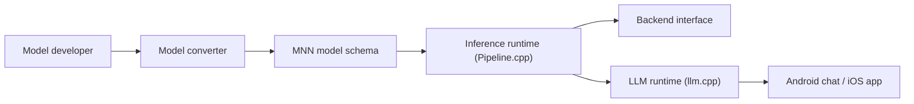

# alibaba/MNN

> Lightweight inference and training engine for mobile and embedded devices, with local execution of LLMs and diffusion models.

## The problem
Deploying models on a phone or embedded device requires a small, fast, portable engine with no dependencies.

## What it actually does
Converts TensorFlow, Caffe, ONNX and Torchscript models to the MNN format, then runs them on CPU (optimized ARM/x64 assembly) or GPU (Metal, OpenCL, Vulkan, CUDA); FP16/Int8 quantization. MNN-LLM and MNN-Diffusion run LLMs and Stable Diffusion locally; Android/iOS chat applications. Used in more than 30 Alibaba applications.

## How it is wired

## Trying it
No command in the README; it points to the Read the Docs documentation and to the MNN-LLM / MNN-Diffusion guides.

## Cost and gotchas
Free. The support table flags "B" cells (bugs or not optimized) for some precisions and NPUs. Built with CMake (not detailed in the README).

## What it is not
Not a research framework like PyTorch: it targets on-device deployment.

## Alternatives
The README compares against TensorFlow Lite, PyTorch Mobile and TVM (benchmarks from the paper).

## For you
Worth watching: relevant if you deploy quantized models on mobile or embedded devices; for server-side serving, there are better-suited options.
