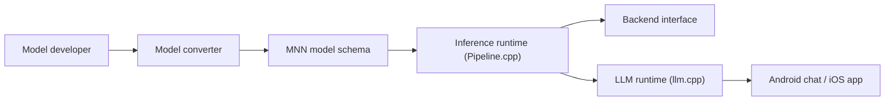

# alibaba/MNN

> Moteur d'inférence et d'entraînement léger pour mobiles et embarqués, avec exécution locale de LLM et de diffusion.

## Le problème
Déployer des modèles sur téléphone ou appareil embarqué exige un moteur petit, rapide et portable, sans dépendances.

## Ce que ça fait vraiment
Convertit des modèles TensorFlow, Caffe, ONNX et Torchscript au format MNN, puis les exécute sur CPU (assembleur optimisé ARM/x64) ou GPU (Metal, OpenCL, Vulkan, CUDA) ; quantification FP16/Int8. MNN-LLM et MNN-Diffusion font tourner LLM et Stable Diffusion en local ; applications Android/iOS de chat. Utilisé dans plus de 30 applications d'Alibaba.

## Comment c'est branché

## Essayer
Aucune commande dans le README ; renvoi à la documentation Read the Docs et aux guides MNN-LLM / MNN-Diffusion.

## Coût et pièges
Gratuit. Le tableau de support signale des cases « B » (bugs ou non optimisé) pour certaines précisions et NPU. Compilation par CMake (non détaillée dans le README).

## Ce que ce n'est pas
Pas un framework de recherche à la PyTorch : il vise le déploiement sur appareil.

## Alternatives
Le README compare à TensorFlow Lite, PyTorch Mobile et TVM (benchmarks de l'article).

## Pour toi
À surveiller : pertinent si tu déploies des modèles quantifiés sur mobile ou embarqué ; pour du serving serveur, il y a mieux adapté.

