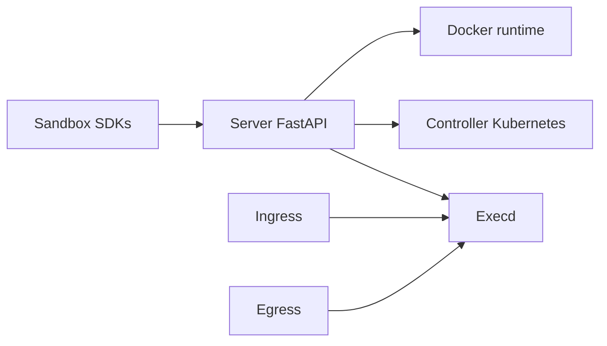

# alibaba/OpenSandbox

> Sandbox platform for AI applications, with multi-language SDKs, running on Docker or Kubernetes.

## The problem
An agent that executes code or drives a browser needs an isolated environment, with files, commands and network policy.

## What it actually does
A FastAPI server creates sandboxes on Docker or Kubernetes. Inside each sandbox, `execd` runs commands, files and code. An ingress proxy routes incoming traffic, and an egress component enforces the network policy. SDKs for Python, JS, Java/Kotlin, C# and Go, plus a CLI (`osb`) and an MCP server.

## How it is wired


## Trying it
```bash
uvx opensandbox-server init-config ~/.sandbox.toml --example docker
uvx opensandbox-server
uv pip install opensandbox
```

## Cost and gotchas
Docker required locally, Python 3.10+. For strong isolation you need gVisor, Kata or Firecracker: configuration is at your expense. The README recommends pinning images by digest.

## What it is not
Not an agent, only the execution environment. The license is not declared in the catalog.

## Alternatives
The README mentions kubernetes-sigs/agent-sandbox, with an integration example.

## For you
Worth adopting to test if you have an agent execute code: it separates execution from the rest and is driven from Python. Check the license first.
