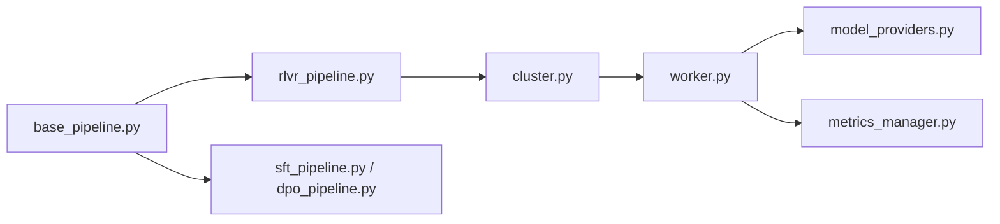

# alibaba/ROLL

> Distributed reinforcement learning library for LLMs, on Ray, Megatron-Core, vLLM and SGLang.

## The problem
Post-training LLMs with reinforcement learning (reasoning, alignment, multi-turn agents) at scale requires orchestrating training and generation across many GPUs.

## What it actually does
Multi-role architecture on Ray with RLVR pipelines (verifiable rewards), agentic RL (multi-turn), distillation, DPO and SFT. Algorithms: PPO, GRPO, Reinforce++, GSPO, TOPR, GiGPO, StarPO. Generation through vLLM or SGLang, training through FSDP2 or Megatron-LM, LoRA, automatic device mapping and tracking with SwanLab, WandB or TensorBoard. The analyzed code also mentions diffusion training.

## How it is wired

## Trying it
No command documented in the README provided: it points to the Installation and Quick Start guides and to the pipelines.

## Cost and gotchas
Assumes a GPU fleet (from a single machine to thousands of GPUs); asynchronous training is still "being implemented" and FP8 in BF16 is "in development". 133 open issues.

## What it is not
Not a tool for a single workstation: designed for clusters. The README cites many internal Alibaba works as a showcase.

## Alternatives
No alternative cited in the README.

## For you
Worth watching: a reference if you do post-training RL on a cluster, disproportionate otherwise.
