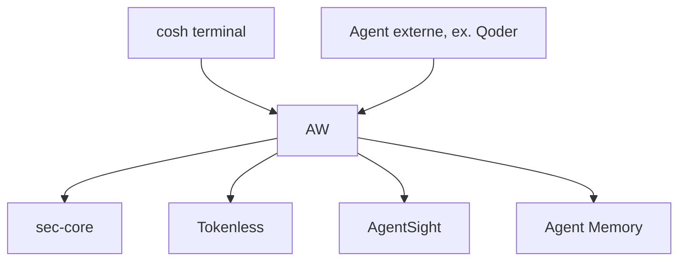

# alibaba/anolisa

> System software stack for AI agents: cosh terminal, memory, security, snapshots and observability.

## The problem
On the system side, AI agents lack context management, action constraints, rollback of the workspace and execution traces.

## What it actually does
Assembles components: cosh (AI terminal), OS Skills, Tokenless (compression of tool outputs), Agent Memory, SkillFS, ws-ckpt (snapshots), Agent Security Core, AgentSight (traces and tokens). AW connects the agent to the components through a provider protocol.

## How it is wired
Simplified diagram based on the sheet, no diagram provided.



## Trying it
```bash
aw config init --prefix "$AW_PREFIX" --config "$AW_HOME/anolisa.yaml" --state-dir "$AW_HOME/anolisa-state" --qoder "$(command -v qodercli)" --provider sec-core+tokenless --socket "$AW_SEC_SOCKET"
aw validate --config "$AW_HOME/anolisa.yaml"
aw run --config "$AW_HOME/anolisa.yaml" --agent qoder
```

## Cost and gotchas
Linux Preview version, glibc 2.39 or higher, Qoder CLI 1.1.64 connected for the example. 1,284 open issues. The Blaze component has been moved to another repository.

## What it is not
Not an agent framework: it wraps existing ones without replacing them. Not a complete operating system shipped here.

## Alternatives
None cited in the README.

## For you
Watch: agent observability and snapshots interest an MLOps profile, but the stack is young, broad and in preview.
