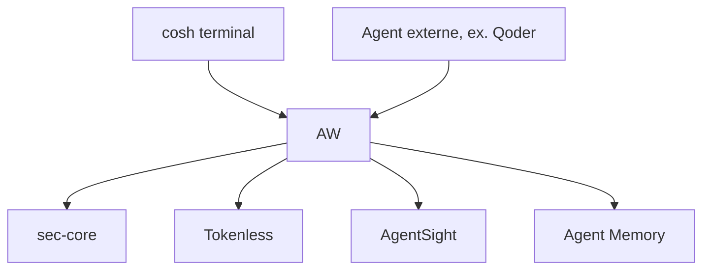

# alibaba/anolisa

> Pile logicielle système pour agents IA : terminal cosh, mémoire, sécurité, snapshots et observabilité.

## Le problème
Les agents d'IA manquent, côté système, de gestion de contexte, de contraintes d'action, de retour arrière sur l'espace de travail et de traces d'exécution.

## Ce que ça fait vraiment
Assemble des composants : cosh (terminal IA), OS Skills, Tokenless (compression de sorties d'outils), Agent Memory, SkillFS, ws-ckpt (snapshots), Agent Security Core, AgentSight (traces et jetons). AW relie l'agent aux composants via un protocole de fournisseurs.

## Comment c'est branché
Schéma simplifié d'après la fiche, sans diagramme fourni.



## Essayer
```bash
aw config init --prefix "$AW_PREFIX" --config "$AW_HOME/anolisa.yaml" --state-dir "$AW_HOME/anolisa-state" --qoder "$(command -v qodercli)" --provider sec-core+tokenless --socket "$AW_SEC_SOCKET"
aw validate --config "$AW_HOME/anolisa.yaml"
aw run --config "$AW_HOME/anolisa.yaml" --agent qoder
```

## Coût et pièges
Version Linux Preview, glibc 2.39 ou plus, Qoder CLI 1.1.64 connecté pour l'exemple. 1 284 issues ouvertes. Le composant Blaze a été déplacé dans un autre dépôt.

## Ce que ce n'est pas
Pas un framework d'agents : il entoure ceux qui existent sans les remplacer. Pas un système d'exploitation complet livré ici.

## Alternatives
Aucune citée dans le README.

## Pour toi
Surveiller : l'observabilité et les snapshots d'agents intéressent un profil MLOps, mais la pile est jeune, large et en préversion.

