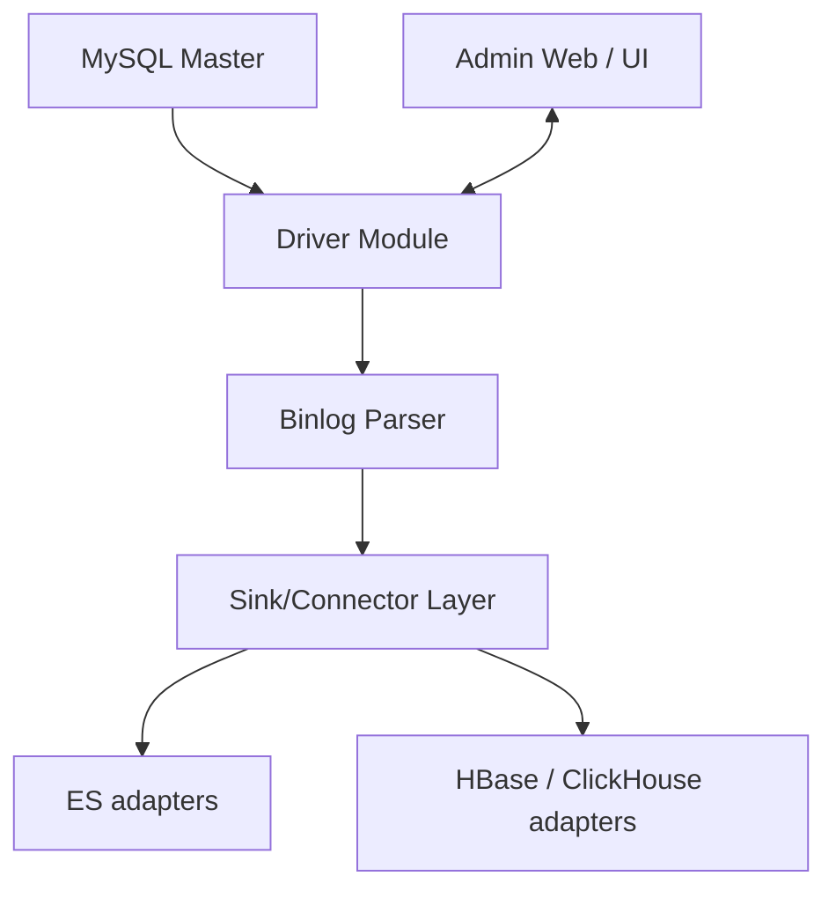

# alibaba/canal

> Java tool that reads MySQL binlogs to publish data changes as a stream, without triggers.

## The problem
Synchronizing caches, search indexes or database copies in real time without triggers or repeated polling queries.

## What it actually does
Poses as a MySQL replica, receives the binlogs, decodes them and distributes them to clients (protobuf protocol) or to Kafka and RocketMQ. Adapters (Elasticsearch, HBase, ClickHouse, RDB) exist, as well as canal-admin (web interface) and a Prometheus export. MySQL sources 5.1 to 8.0.

## How it is wired


## Trying it
The README provided lists guides (QuickStart, Docker QuickStart) without giving a command.
```bash
# aucune commande documentée dans le README fourni
```

## Cost and gotchas
Free. Requires a MySQL with binlog enabled. README in Chinese; documentation on the repository wiki. Last push in July 2026.

## What it is not
Not a complete replication tool: it reads and forwards changes, and consumption is up to you. MySQL only.

## Alternatives
- Otter: a consumer of canal.
- DTS: Alibaba's real-time synchronization.
- DataX: offline synchronization.

## For you
To keep an eye on: useful for feeding a data pipeline from MySQL as a stream, but the README gives no start command.
