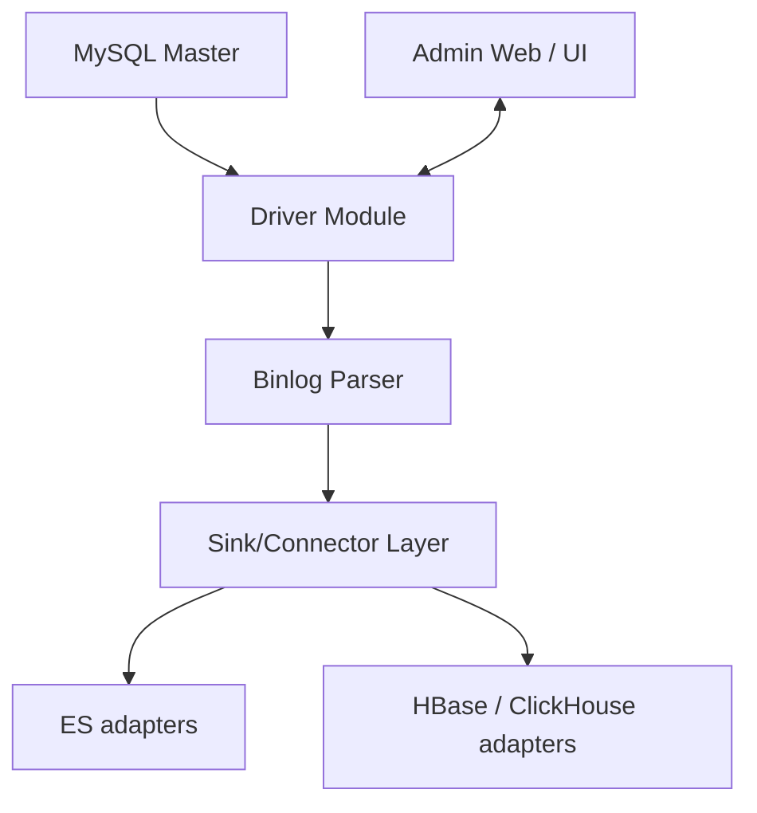

# alibaba/canal

> Outil Java qui lit les binlogs MySQL pour publier les changements de données en flux, sans trigger.

## Le problème
Synchroniser caches, index de recherche ou copies de bases en temps réel sans triggers ni requêtes d'interrogation répétées.

## Ce que ça fait vraiment
Se fait passer pour un réplica MySQL, reçoit les binlogs, les décode et les distribue à des clients (protocole protobuf) ou à Kafka et RocketMQ. Des adaptateurs (Elasticsearch, HBase, ClickHouse, RDB) existent, ainsi que canal-admin (interface web) et un export Prometheus. Sources MySQL 5.1 à 8.0.

## Comment c'est branché


## Essayer
Le README fourni liste des guides (QuickStart, Docker QuickStart) sans donner de commande.
```bash
# aucune commande documentée dans le README fourni
```

## Coût et pièges
Gratuit. Exige un MySQL avec binlog activé. README en chinois ; documentation sur le wiki du dépôt. Dernier push en juillet 2026.

## Ce que ce n'est pas
Pas un outil de réplication complet : il lit et transmet les changements, la consommation reste à ta charge. MySQL uniquement.

## Alternatives
- Otter : consommateur de canal.
- DTS : synchronisation en temps réel d'Alibaba.
- DataX : synchronisation hors ligne.

## Pour toi
À surveiller : utile pour alimenter un pipeline de données depuis MySQL en flux, mais le README ne donne aucune commande de démarrage.

