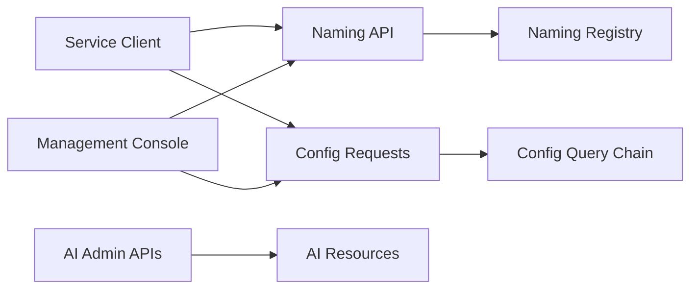

# alibaba/nacos

> Service discovery and dynamic configuration server for microservice architectures.

## The problem
Microservices that must find each other and reload their configuration without redeployment, without hand-coding that plumbing.

## What it actually does
Nacos offers four functions: service registration and discovery with health checks (DNS or HTTP), centralized configuration editable on the fly, dynamic DNS with weighted routing, and a metadata management console. It covers Dubbo, gRPC, Spring Cloud and Kubernetes services. The described architecture also shows an "AI Resources" component (import, publication, scan of skills), not detailed in the README.

## How it is wired


## Trying it
```bash
unzip nacos-server-1.0.0.zip
cd nacos/bin
sh startup.sh -m standalone
```

## Cost and gotchas
Free when self-hosted; the managed version goes through Alibaba Cloud MSE (paid). Exact prerequisite (JDK) not specified in the README. The README is strongly oriented toward the Chinese ecosystem (DingTalk, Weibo).

## What it is not
Not a workflow orchestrator nor a service mesh. Nothing AI-specific in the README, despite the "AI" component seen in the directory tree.

## Alternatives
- spring-cloud-alibaba: the turnkey integration with Alibaba middleware, cited in the README.
- nacos-group: SDKs and ancillary tools of the ecosystem.

## For you
Ignore unless you have to operate Java/Spring microservices: this is platform infrastructure, not a data science or MLOps tool.
