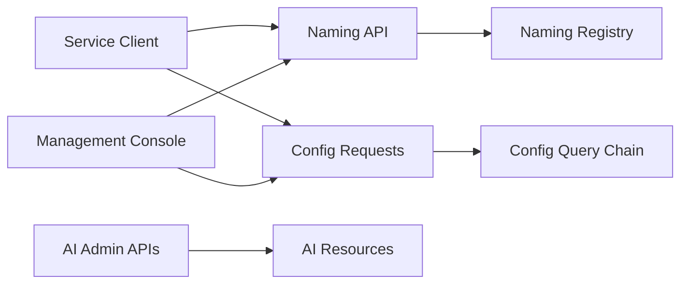

# alibaba/nacos

> Serveur de découverte de services et de configuration dynamique pour architectures microservices.

## Le problème
Des microservices qui doivent se retrouver et recharger leur configuration sans redéploiement, sans coder cette plomberie à la main.

## Ce que ça fait vraiment
Nacos offre quatre fonctions : enregistrement et découverte de services avec health checks (DNS ou HTTP), configuration centralisée modifiable à chaud, DNS dynamique avec routage pondéré, console de gestion des métadonnées. Il couvre services Dubbo, gRPC, Spring Cloud et Kubernetes. L'architecture décrite montre aussi un volet « AI Resources » (import, publication, scan de skills), non détaillé dans le README.

## Comment c'est branché


## Essayer
```bash
unzip nacos-server-1.0.0.zip
cd nacos/bin
sh startup.sh -m standalone
```

## Coût et pièges
Gratuit en auto-hébergement ; la version gérée passe par Alibaba Cloud MSE (payant). Prérequis exact (JDK) non précisé dans le README. Le README est très orienté écosystème chinois (DingTalk, Weibo).

## Ce que ce n'est pas
Pas un orchestrateur de workflows ni un service mesh. Rien de spécifique à l'IA dans le README, malgré le volet « AI » vu dans l'arborescence.

## Alternatives
- spring-cloud-alibaba : l'intégration clé en main avec les middlewares Alibaba, citée dans le README.
- nacos-group : SDK et outils annexes de l'écosystème.

## Pour toi
À ignorer sauf si tu dois opérer des microservices Java/Spring : c'est de l'infrastructure de plateforme, pas un outil de data science ou de MLOps.

