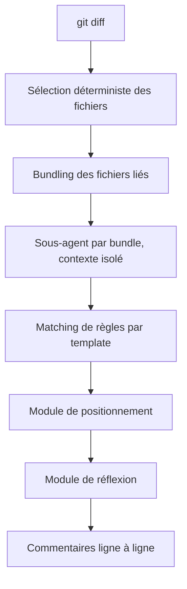

# alibaba/open-code-review

> Code review command line generated by an LLM, based on Alibaba's internal tool, with a focus on accuracy over recall.

## The problem
A general-purpose agent, when assigned to a large and complex task, may struggle with file management, place comments in the wrong locations, and introduce instability.

The cause: a purely language-based architecture, without strict constraints on the review process.

## What it actually does
Reads the Git differences, sends modified files to a configurable LLM via a tool-assisted agent, and generates structured, line-by-line comments.

The deterministic part is the code, not the prompt: precise file selection, grouping related files into isolated review units (concurrent sub-agents), fine-grained rule matching per file, and external modules for positioning and reasoning.

The agent part only retains the dynamic decision-making: prompts and specialized tools are reviewed and distilled from production call traces.
`OCR scan` reviews entire files without differences; the delegation mode allows your own agent to perform the review, with OCR only handling selection and rules.

## How it is wired


## Trying it
```bash
npm install -g @alibaba-group/open-code-review
ocr config provider
ocr config model
ocr review --from main --to feature-branch
ocr scan --path internal/agent
```

## Cost and gotchas
Git version 2.41 or higher is required. A model endpoint needs to be configured, except in delegation mode where your agent provides its own.

The README document describes an OpenTelemetry integration for observability: this should be verified before deploying in a production environment.

## What it is not
This is not a high-recall tool: the README indicates lower recall compared to general-purpose tools, with a trade-off against noise.
It is not a replacement for human review, nor a static linter.
The benchmark cited (50 repositories, 200 PRs, 1,505 annotated issues) was produced by the project.

## Alternatives
- Claude Code with Skills — compared directly in the README as the standard general-purpose agent.
- Codex, Cursor, Kimi Code, OpenCode – these are supported as delegation hosts rather than competing platforms.

## For you
This is interesting if you want automatic review in CI with few false positives; the delegation mode avoids the need for a second API key.
