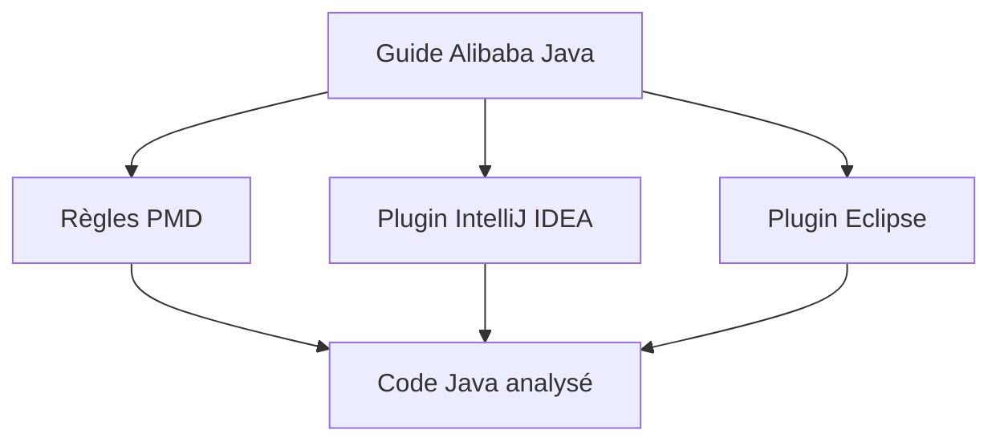

# alibaba/p3c

> PMD rules and IntelliJ/Eclipse plugins enforcing Alibaba's Java conventions, for Java teams.

## The problem
Large Java teams produce heterogeneous code that is hard to maintain and sometimes vulnerable.

## What it actually does
The project has three parts: rules implemented with PMD (49 rules), an IntelliJ IDEA plugin and an Eclipse plugin. Four additional rules live in the plugins: deprecated method forbidden, `@Override` mandatory, static access by class name, `hashCode`/`equals` consistency. The reference guide exists as a PDF (Huangshan version, 2022).

## How it is wired
Simplified diagram based on the sheet, no diagram provided.

## Trying it
No command documented in the README, which points to the P3C-PMD documentation and the PDF guide.

## Cost and gotchas
Free. A Java environment and an IntelliJ or Eclipse IDE are required (outside the standard prerequisites list). Last push in August 2024, more than a year ago: the rules may no longer keep up with recent Java versions.

## What it is not
It is not a multi-language analyzer nor a security tool: it only covers Java. The README mixes Chinese and English.

## Alternatives
No alternative named in the README.

## For you
Ignore: Java tool with little activity since 2024; a data / AI profile writing mostly Python will get nothing from it.
