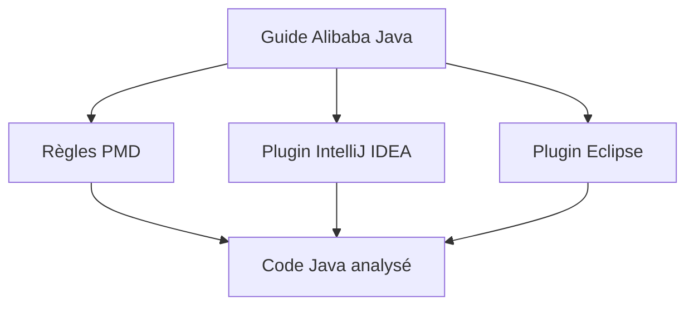

# alibaba/p3c

> Règles PMD et plugins IntelliJ/Eclipse appliquant les conventions Java d'Alibaba, pour équipes Java.

## Le problème
Des équipes Java nombreuses produisent un code hétérogène, difficile à maintenir et parfois vulnérable.

## Ce que ça fait vraiment
Le projet comprend trois parties : des règles implémentées avec PMD (49 règles), un plugin IntelliJ IDEA et un plugin Eclipse. Quatre règles supplémentaires vivent dans les plugins : méthode dépréciée interdite, `@Override` obligatoire, accès statique par nom de classe, cohérence `hashCode`/`equals`. Le guide de référence existe en PDF (version Huangshan, 2022).

## Comment c'est branché
Schéma simplifié d'après la fiche, sans diagramme fourni.

## Essayer
Aucune commande documentée dans le README, qui renvoie à la documentation P3C-PMD et au guide PDF.

## Coût et pièges
Gratuit. Il faut un environnement Java et un IDE IntelliJ ou Eclipse (hors liste des prérequis standard). Dernier push en août 2024, soit plus d'un an : les règles risquent de ne plus suivre les versions récentes de Java.

## Ce que ce n'est pas
Ce n'est pas un analyseur multi-langages ni un outil de sécurité : il ne couvre que Java. Le README mélange chinois et anglais.

## Alternatives
Aucune alternative nommée dans le README.

## Pour toi
À ignorer : outil Java peu actif depuis 2024 ; un profil data / IA qui écrit surtout en Python n'en tirera rien.

