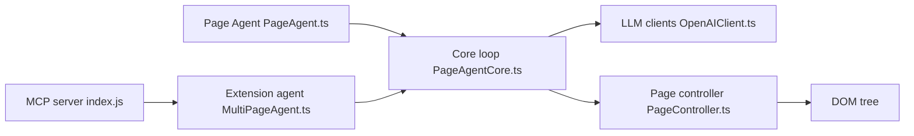

# alibaba/page-agent

> JavaScript library that gives a web page its own AI agent, with no extension or headless browser.

## The problem
Adding a copilot to a SaaS product or automating forms usually requires a backend or screenshots.

## What it actually does
A script or the `page-agent` package reads the DOM as text (no screenshot, no multimodal model), sends the instruction to an OpenAI-compatible LLM and executes the actions on the page (clicks, typing). An optional Chrome extension covers multi-tab use, and an MCP server (beta) allows remote control. The DOM and prompt derive from browser-use (MIT).

## How it is wired


## Trying it
```bash
npm install page-agent
```
```javascript
import { PageAgent } from 'page-agent'
const agent = new PageAgent({ model: 'qwen3.5-plus', baseURL: 'https://dashscope.aliyuncs.com/compatible-mode/v1', apiKey: 'YOUR_API_KEY', language: 'en-US' })
await agent.execute('Click the login button')
```

## Cost and gotchas
LLM API key at your expense. The CDN demo script uses a free test API, reserved for technical evaluation. The page's DOM is sent to the chosen model.

## What it is not
Not server-side automation: designed for client-side enhancement. The README states it is not a scraping tool.

## Alternatives
browser-use, from which the project derives; Stagehand, by Browserbase, for driving a browser with an LLM.

## For you
To keep an eye on: useful for a copilot embedded in a business application, but the page content goes to a model provider.
