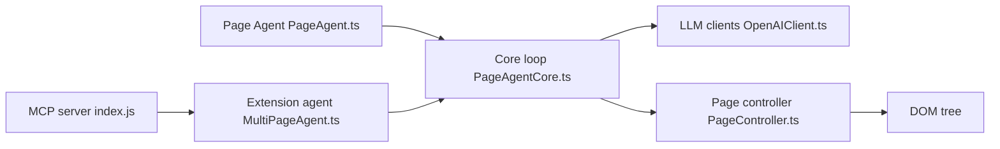

# alibaba/page-agent

> Bibliothèque JavaScript qui donne à une page web son propre agent IA, sans extension ni navigateur sans tête.

## Le problème
Ajouter un copilote dans un produit SaaS ou automatiser des formulaires demande habituellement un backend ou des captures d'écran.

## Ce que ça fait vraiment
Un script ou le paquet `page-agent` lit le DOM en texte (sans capture, sans modèle multimodal), envoie la consigne à un LLM compatible OpenAI et exécute les actions sur la page (clics, saisie). Une extension Chrome optionnelle couvre le multi-onglets, et un serveur MCP (bêta) permet de piloter à distance. DOM et prompt dérivent de browser-use (MIT).

## Comment c'est branché


## Essayer
```bash
npm install page-agent
```
```javascript
import { PageAgent } from 'page-agent'
const agent = new PageAgent({ model: 'qwen3.5-plus', baseURL: 'https://dashscope.aliyuncs.com/compatible-mode/v1', apiKey: 'YOUR_API_KEY', language: 'en-US' })
await agent.execute('Click the login button')
```

## Coût et pièges
Clé d'API LLM à ta charge. Le script de démonstration par CDN utilise une API de test gratuite, réservée à l'évaluation technique. Le DOM de la page est envoyé au modèle choisi.

## Ce que ce n'est pas
Pas de l'automatisation côté serveur : conçu pour l'amélioration côté client. Le README signale que ce n'est pas un outil de scraping.

## Alternatives
browser-use, dont le projet dérive ; Stagehand, de Browserbase, pour piloter un navigateur par un LLM.

## Pour toi
À surveiller : utile pour un copilote embarqué dans une application métier, mais le contenu des pages part chez un fournisseur de modèle.

