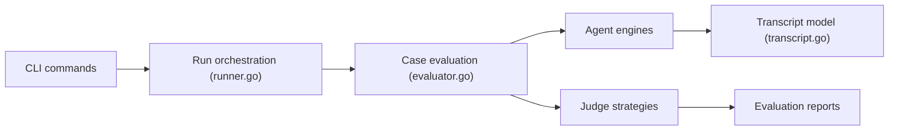

# alibaba/skill-up

> CLI that evaluates Agent Skills through YAML cases and helps improve them in a loop.

## The problem
Measuring the quality of an agent skill remains artisanal: ad hoc run folders, no comparison between engines, no reproducible reports.

## What it actually does
Go CLI: defines the evaluation in `eval.yaml` and `cases/*.yaml`, prepares the workspace, installs the skill, launches an agent engine (Claude Code, Codex, Qoder CLI, Qwen Code or a custom engine), grades with judges (rules, script or agent) and produces `grading.json`, `benchmark.json`, JUnit XML and HTML. The `skill-upper` skill drives the improvement loop through conversation. A GitHub Action runs the evals in CI.

## How it is wired


## Trying it
```bash
curl -fsSL https://raw.githubusercontent.com/alibaba/skill-up/main/install.sh | bash
skill-up init
skill-up validate
skill-up run
skill-up import ./evals/evals.json --output ./evals
```

## Cost and gotchas
Free, but each run calls an agent engine with your key or subscription. The GitHub action is Linux only. The project dates from May 2026.

## What it is not
Not a model benchmark: it evaluates skills. It improves skills through conversation, with no guarantee of results.

## Alternatives
No alternative named in the README.

## For you
Worth watching: relevant if you write or maintain Agent Skills and want evals in CI; the project is young, but its compatibility with Anthropic's `evals.json` limits lock-in risk.
