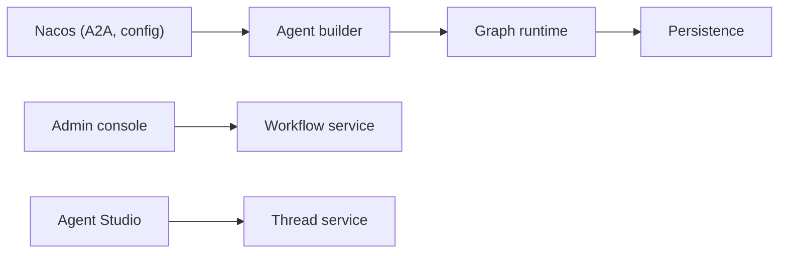

# alibaba/spring-ai-alibaba

> Java framework for agents, workflows and multi-agent systems, with an administration platform.

## The problem
Building agents in Java means assembling orchestration, memory, MCP and tracking yourself.

## What it actually does
Three layers: an Agent Framework (ReactAgent, Sequential/Parallel/Routing/Loop, human-in-the-loop, context engineering), a Graph runtime (persistence, streaming, PlantUML/Mermaid export) and an Admin platform (visual development, evaluation, tracing, MCP management). A2A support via Nacos, voice over WebSocket, DashScope, OpenAI models, etc.

## How it is wired


## Trying it
```bash
git clone --depth=1 https://github.com/alibaba/spring-ai-alibaba.git
cd spring-ai-alibaba
export AI_DASHSCOPE_API_KEY=your-api-key
./mvnw -pl examples/chatbot spring-boot:run
```

## Cost and gotchas
Requires JDK 17+ and an API key (example: DashScope via Alibaba Cloud Bailian), billed to you.

## What it is not
Not Python: it is a Spring/Java ecosystem. The README does not detail several internal Admin links.

## Alternatives
None named, apart from Spring AI, whose concepts it extends.

## For you
Worth watching if your IT stack is Java/Spring; otherwise a Python framework will serve you better.
