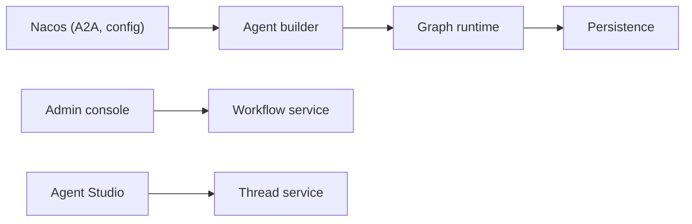

# alibaba/spring-ai-alibaba

> Framework Java pour agents, workflows et multi-agents, avec plateforme d'administration.

## Le problème
Construire des agents en Java demande d'assembler soi-même orchestration, mémoire, MCP et suivi.

## Ce que ça fait vraiment
Trois couches : un Agent Framework (ReactAgent, Sequential/Parallel/Routing/Loop, human-in-the-loop, context engineering), un runtime Graph (persistance, flux, export PlantUML/Mermaid) et une plateforme Admin (développement visuel, évaluation, traçage, gestion MCP). Support A2A via Nacos, voix par WebSocket, modèles DashScope, OpenAI, etc.

## Comment c'est branché


## Essayer
```bash
git clone --depth=1 https://github.com/alibaba/spring-ai-alibaba.git
cd spring-ai-alibaba
export AI_DASHSCOPE_API_KEY=your-api-key
./mvnw -pl examples/chatbot spring-boot:run
```

## Coût et pièges
Il faut JDK 17+ et une clé d'API (exemple : DashScope via Alibaba Cloud Bailian), facturée à ta charge.

## Ce que ce n'est pas
Pas du Python : écosystème Spring/Java. Le README ne détaille pas plusieurs liens internes de l'Admin.

## Alternatives
Aucune alternative nommée, hors Spring AI dont il étend les concepts.

## Pour toi
À surveiller si ton SI est en Java/Spring ; sinon un framework Python te sert mieux.

