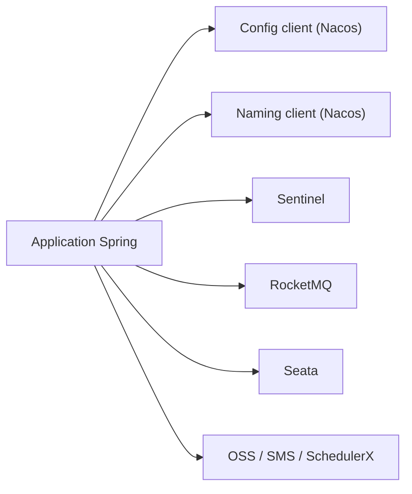

# alibaba/spring-cloud-alibaba

> Spring Cloud integrations to connect Java applications to Nacos, Sentinel, RocketMQ, Seata and Alibaba Cloud.

## The problem
Building Spring microservices requires service discovery, distributed configuration, rate limiting and distributed transactions.

## What it actually does
Maven/Gradle starters connect a Spring app to Nacos (discovery and configuration), Sentinel (flow control, circuit breaking), RocketMQ (messaging), Seata (transactions) and Alibaba Cloud's OSS, SMS and SchedulerX services. Versions follow those of Spring Boot (2025.1.x for Boot 4.0.x). An enterprise offering (MSE) adds governance.

## How it is wired


## Trying it
```bash
./mvnw install
```
The README also gives the declaration of the `spring-cloud-alibaba-dependencies` BOM (version 2025.1.0.0).

## Cost and gotchas
Free library; OSS, SMS and SchedulerX are paid Alibaba Cloud services. Snapshots require a GitHub token with `read:packages`.

## What it is not
Not a standalone framework: it assumes Spring Boot and JDK 17+ for recent versions.

## Alternatives
No alternative named in the README.

## For you
Ignore: Java microservices stack centered on Alibaba Cloud, of no value for a data / AI / MLOps profile in Python.
