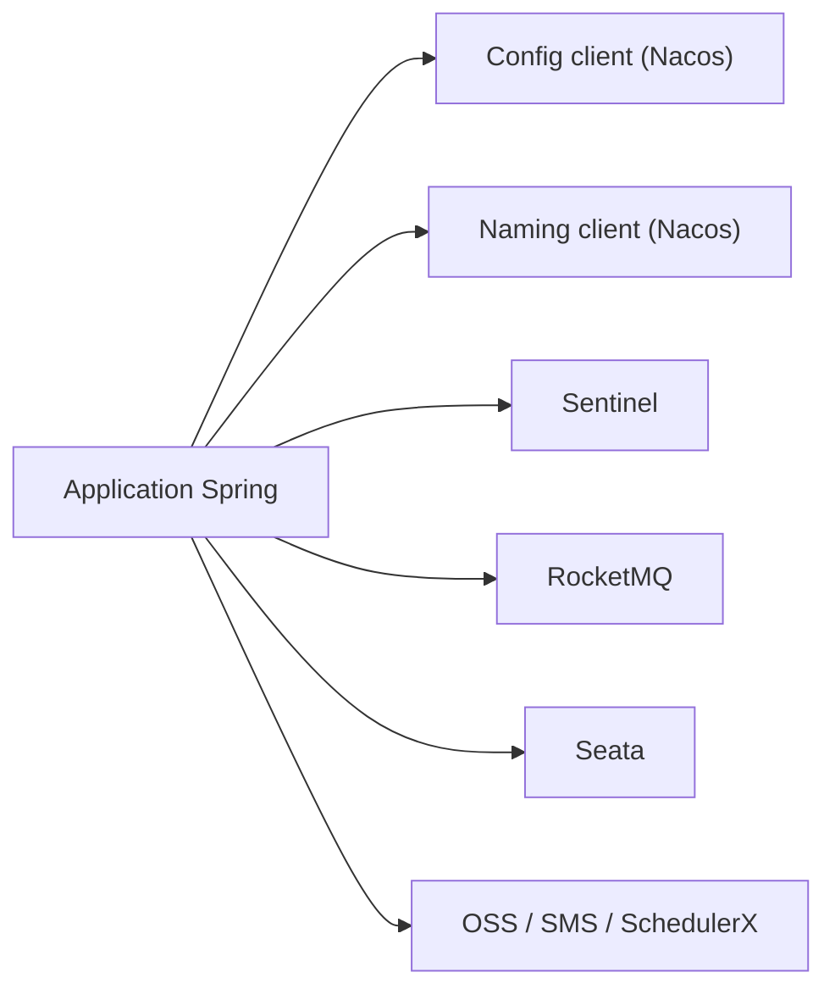

# alibaba/spring-cloud-alibaba

> Intégrations Spring Cloud pour brancher des applications Java sur Nacos, Sentinel, RocketMQ, Seata et Alibaba Cloud.

## Le problème
Construire des microservices Spring demande découverte de services, configuration distribuée, limitation de débit et transactions distribuées.

## Ce que ça fait vraiment
Des starters Maven/Gradle connectent une appli Spring à Nacos (découverte et configuration), Sentinel (flux, coupe-circuit), RocketMQ (messages), Seata (transactions) et aux services OSS, SMS et SchedulerX d'Alibaba Cloud. Les versions suivent celles de Spring Boot (2025.1.x pour Boot 4.0.x). Une offre entreprise (MSE) ajoute la gouvernance.

## Comment c'est branché


## Essayer
```bash
./mvnw install
```
Le README donne aussi la déclaration du BOM `spring-cloud-alibaba-dependencies` (version 2025.1.0.0).

## Coût et pièges
Bibliothèque gratuite ; OSS, SMS et SchedulerX sont des services Alibaba Cloud payants. Les snapshots demandent un jeton GitHub avec `read:packages`.

## Ce que ce n'est pas
Pas un framework autonome : il suppose Spring Boot et JDK 17+ pour les versions récentes.

## Alternatives
Aucune alternative nommée dans le README.

## Pour toi
À ignorer : stack Java microservices centrée sur Alibaba Cloud, sans valeur pour un profil data / IA / MLOps en Python.

