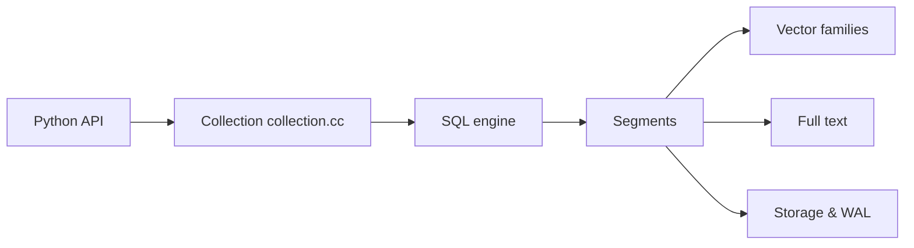

# alibaba/zvec

> In-process embedded vector database, with full-text and hybrid search.

## The problem
A dedicated vector server is heavy for a notebook, a command-line tool or an edge device.

## What it actually does
C++ library with Python, Node.js, Go, Rust and Dart SDKs. Dense and sparse vectors, flat, HNSW, IVF, DiskANN and Vamana indexes, quantization, BM25 full-text search, structured filters and hybrid queries. Write-ahead log (WAL) for durability; several processes can read, only one writes. Version 0.8.0 adds Intel Mac, Windows ARM64 and a built-in Chinese dictionary.

## How it is wired


## Trying it
```bash
pip install zvec
```
```python
import zvec
schema = zvec.CollectionSchema(name="example", vectors=zvec.VectorSchema("embedding", zvec.DataType.VECTOR_FP32, 4))
collection = zvec.create_and_open(path="./zvec_example", schema=schema)
```

## Cost and gotchas
Free; Python 3.10 to 3.14, 64-bit. Only one simultaneous writer per collection. The README points to benchmarks without publishing the detailed figures in the text provided.

## What it is not
Not a network server: no remote API. The gain from uniform quantization may reduce recall (according to the release notes).

## Alternatives
No alternative named in the README (zvec-grep and Zvec Studio are companion tools).

## For you
Adopt: a simple local vector database for RAG prototypes and embedded applications; validate recall on your own data.
