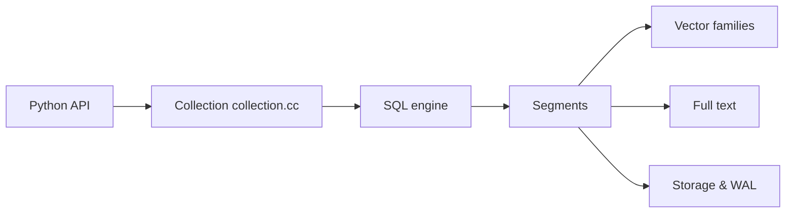

# alibaba/zvec

> Base de données vectorielle embarquée dans le processus, avec recherche plein texte et hybride.

## Le problème
Un serveur de vecteurs dédié est lourd pour un notebook, un outil en ligne de commande ou un appareil en périphérie.

## Ce que ça fait vraiment
Bibliothèque C++ avec SDK Python, Node.js, Go, Rust, Dart. Vecteurs denses et creux, index flat, HNSW, IVF, DiskANN et Vamana, quantification, recherche plein texte BM25, filtres structurés et requêtes hybrides. Journal d'écriture (WAL) pour la durabilité ; plusieurs processus peuvent lire, un seul écrit. La version 0.8.0 ajoute Intel Mac, Windows ARM64 et un dictionnaire chinois intégré.

## Comment c'est branché


## Essayer
```bash
pip install zvec
```
```python
import zvec
schema = zvec.CollectionSchema(name="example", vectors=zvec.VectorSchema("embedding", zvec.DataType.VECTOR_FP32, 4))
collection = zvec.create_and_open(path="./zvec_example", schema=schema)
```

## Coût et pièges
Gratuit ; Python 3.10 à 3.14 en 64 bits. Une seule écriture simultanée par collection. Le README renvoie aux benchmarks sans publier les chiffres détaillés dans le texte fourni.

## Ce que ce n'est pas
Pas un serveur réseau : aucune API à distance. Le gain de la quantification uniforme peut réduire le rappel (dit par les notes de version).

## Alternatives
Aucune alternative nommée dans le README (zvec-grep et Zvec Studio sont des outils compagnons).

## Pour toi
À adopter : base vectorielle locale simple pour prototypes RAG et applications embarquées ; valide le rappel sur tes propres données.

