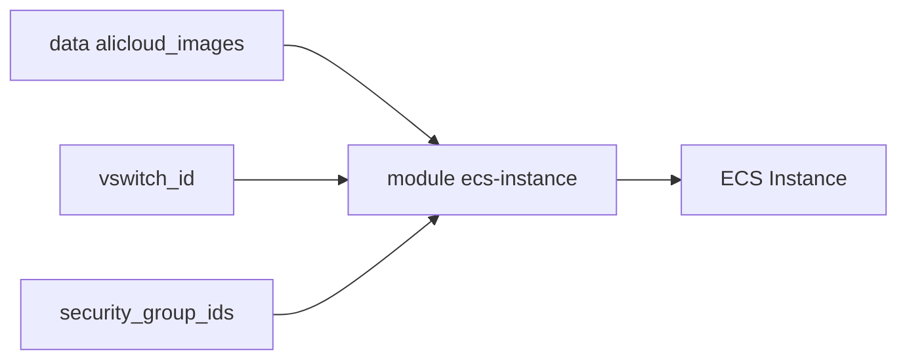

# alibabacloud-automation/terraform-alicloud-ecs-instance

> Terraform module that creates ECS instances on Alibaba Cloud, for infrastructure teams.

## The problem
Creating ECS instances by hand with disks, network and keys is repetitive.

## What it actually does
Creates one or more ECS instances in a VPC: type, image, vswitch, security groups, system disk, public IP, bandwidth. The examples cover additional disks, EIP, bare-metal, GPU, FPGA and several x86 families. Since v2.8.0, the `provider` block has been removed from the module.

## How it is wired
Simplified diagram based on the sheet, no diagram provided.



## Trying it
```hcl
module "ecs_cluster" {
  source  = "alibaba/ecs-instance/alicloud"
  number_of_instances = 5
  name                = "my-ecs-cluster"
}
```
Reduced excerpt of the README example; it also requires image, type and network.

## Cost and gotchas
Alibaba Cloud account required; instances are billed. Terraform 0.13 or later. The README discourages opening issues here and points to the provider. It states an Apache 2 license while the catalog indicates MIT.

## What it is not
Not a multi-cloud module: it covers only Alibaba Cloud and a single resource type, the ECS instance.

## Alternatives
No alternative named in the README.

## For you
Ignore: only relevant if your GPUs run on Alibaba Cloud; otherwise of no interest.
