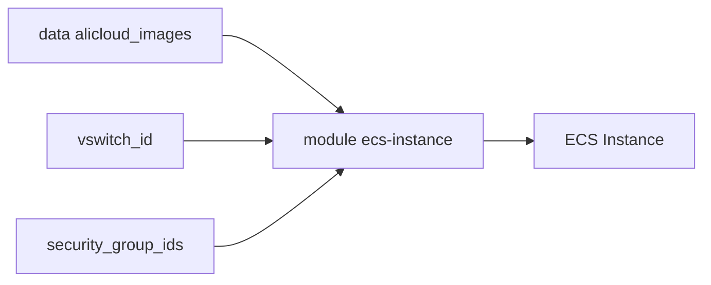

# alibabacloud-automation/terraform-alicloud-ecs-instance

> Module Terraform qui crée des instances ECS sur Alibaba Cloud, pour les équipes infra.

## Le problème
Créer à la main des instances ECS avec disques, réseau et clés est répétitif.

## Ce que ça fait vraiment
Crée une ou plusieurs instances ECS dans un VPC : type, image, vswitch, groupes de sécurité, disque système, IP publique, bande passante. Les exemples couvrent disques additionnels, EIP, bare-metal, GPU, FPGA et plusieurs familles x86. Depuis la v2.8.0, le bloc `provider` a été retiré du module.

## Comment c'est branché
Schéma simplifié d'après la fiche, sans diagramme fourni.



## Essayer
```hcl
module "ecs_cluster" {
  source  = "alibaba/ecs-instance/alicloud"
  number_of_instances = 5
  name                = "my-ecs-cluster"
}
```
Extrait réduit de l'exemple du README ; il demande aussi image, type et réseau.

## Coût et pièges
Compte Alibaba Cloud requis ; instances facturées. Terraform 0.13 ou plus. Le README déconseille d'ouvrir des issues ici et renvoie au provider. Il annonce une licence Apache 2 alors que le catalogue indique MIT.

## Ce que ce n'est pas
Pas un module multi-cloud : il ne couvre qu'Alibaba Cloud et un seul type de ressource, l'instance ECS.

## Alternatives
Aucune alternative nommée dans le README.

## Pour toi
À ignorer : seulement pertinent si tes GPU tournent chez Alibaba Cloud ; sinon aucun intérêt.

