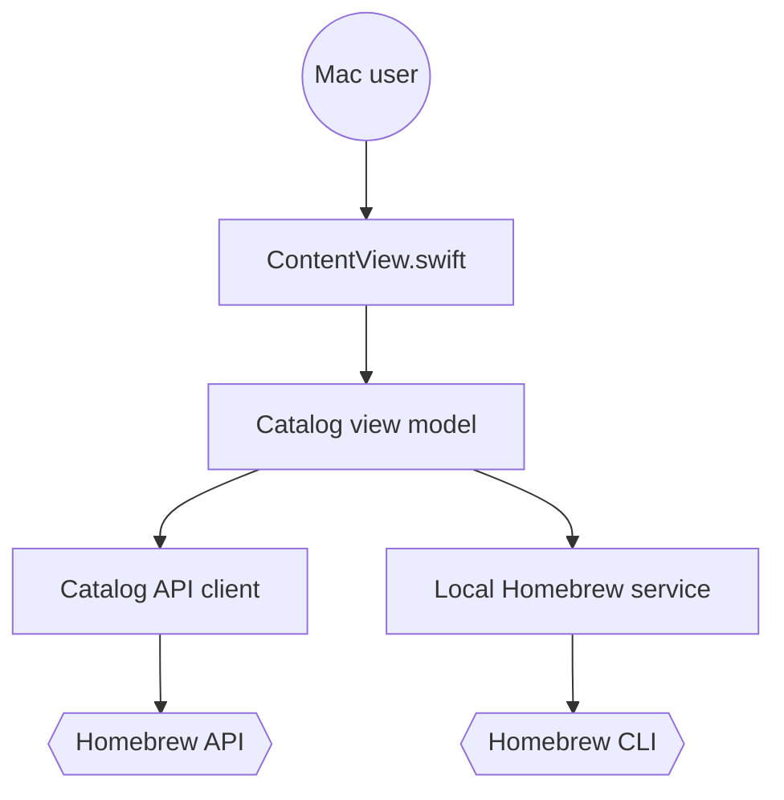

# alielsokary/CaskHub

> Native macOS app store for browsing and managing Homebrew casks.

## The problem
Installing and updating Mac apps through Homebrew is done on the command line, with no catalog or overview.

## What it actually does
SwiftUI app (MVVM): catalog and analytics from the public Homebrew API, detection of installed apps by reading the Caskroom, and install, update and uninstall through the real `brew` binary. Categories, dates and icons come from the releases of the companion CaskFlow pipeline. An "Adopt" feature to put an already installed app under brew. Updates via Sparkle.

## How it is wired


## Trying it
```bash
brew install --cask caskhub
git clone https://github.com/alielsokary/CaskHub.git
xcodebuild test -project CaskHub.xcodeproj -scheme CaskHub -destination 'platform=macOS'
```

## Cost and gotchas
Free. macOS 15.6+, Homebrew required to act (browsing works without it). Building: Xcode 26+. Sends metrics via Sentry and TelemetryDeck (can be disabled in Settings).

## What it is not
Not a replacement for `brew`: it drives it. macOS only, unrelated to data/AI.

## Alternatives
- Homebrew CLI (`brew`): already there, no telemetry.

## For you
Ignore: Mac workstation comfort unrelated to your data/AI/MLOps work, and it adds telemetry where `brew` is enough.
