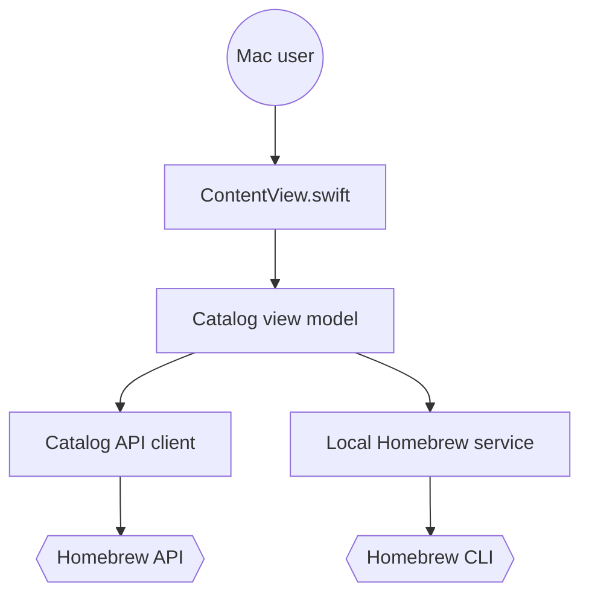

# alielsokary/CaskHub

> Boutique d'applications macOS native pour parcourir et gérer les casks Homebrew.

## Le problème
Installer et mettre à jour des applis Mac via Homebrew se fait en ligne de commande, sans catalogue ni vue d'ensemble.

## Ce que ça fait vraiment
App SwiftUI (MVVM) : catalogue et analytics depuis l'API publique Homebrew, détection des applis installées par lecture du Caskroom, et installation, mise à jour, désinstallation via le vrai binaire `brew`. Catégories, dates et icônes viennent des releases du pipeline compagnon CaskFlow. Fonction « Adopt » pour placer sous brew une appli déjà installée. Mises à jour par Sparkle.

## Comment c'est branché


## Essayer
```bash
brew install --cask caskhub
git clone https://github.com/alielsokary/CaskHub.git
xcodebuild test -project CaskHub.xcodeproj -scheme CaskHub -destination 'platform=macOS'
```

## Coût et pièges
Gratuit. macOS 15.6+, Homebrew requis pour agir (parcourir marche sans). Compilation : Xcode 26+. Envoie des métriques via Sentry et TelemetryDeck (désactivable dans Réglages).

## Ce que ce n'est pas
Pas un remplaçant de `brew` : il le pilote. Cible macOS uniquement, sans rapport avec data/IA.

## Alternatives
- Homebrew CLI (`brew`) : déjà là, sans télémétrie.

## Pour toi
Ignorer : confort de poste Mac sans lien avec ton métier data/IA/MLOps, et il ajoute de la télémétrie là où `brew` suffit.

