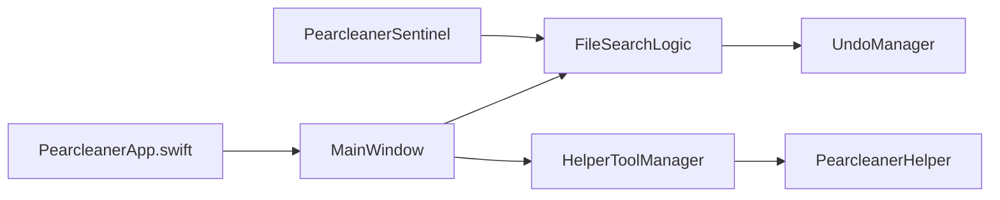

# alienator88/Pearcleaner

> macOS application that cleanly uninstalls applications and their leftover files.

## The problem
Dragging an application to the trash leaves preference files, caches and data scattered across the system.

## What it actually does
SwiftUI application for macOS 13+: searches for files associated with an app, then lets you select and delete them, with history and undo. Also: orphaned file search, Homebrew management, PKG package inspection, application updates, architecture and translation slimming, and a "Sentinel" agent that cleans up when an app goes to the trash. A privileged helper handles system folders.

## How it is wired


## Trying it
```bash
brew install --cask pearcleaner
```

## Cost and gotchas
Free. Requires full disk access and a privileged helper to act on system folders. The project is "on pause": no updates since late 2025, the author having no access to a Mac; issues, PRs and releases are suspended with no end date. Source-available fair-code style license: read it.

## What it is not
Not a security tool nor a fleet administration tool. The author states that their only legitimate site is itsalin.com; other download sources should be avoided.

## Alternatives
The README cites AppCleaner by Freemacsoft as a source of inspiration.

## For you
Ignore: a paused Mac utility, with extended system privileges, unrelated to data/AI/MLOps.
