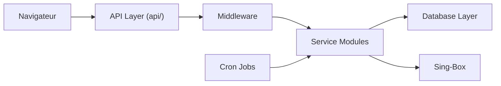

# alireza0/s-ui

> Web administration panel for multi-protocol proxies, built on Sing-Box.

## The problem
Manually configuring the inbounds, outbounds, routing and clients of a Sing-Box core is tedious.

## What it actually does
A Go server with a web interface, REST API (`/apiv2`) and subscription service (links, JSON, Clash). It manages protocols (VLESS, VMess, Trojan, Shadowsocks, Hysteria, TUIC…), clients with quota and expiration, advanced routing, system status, scheduled tasks, a local database and HTTPS with a user-supplied certificate.

## How it is wired


## Trying it
```bash
bash <(curl -Ls https://raw.githubusercontent.com/alireza0/s-ui/master/install.sh)
docker compose up -d
```

## Cost and gotchas
Free. The panel listens on port 2095 with the default login `admin` / `admin`: change it immediately. The README advises against production use and limits it to personal learning.

## What it is not
Not a data/AI tool. Not a production product according to its own warning. The `curl | bash` installer runs a remote script.

## Alternatives
No alternative named in the README.

## For you
Ignore: a proxy panel unrelated to data/AI/MLOps work, and its author advises against it for production.
