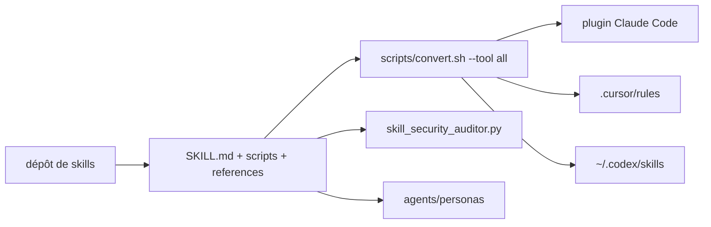

# alirezarezvani/claude-skills

> Library of 388 agent skills, convertible to thirteen coding tools.

## The problem
A coding agent lacks domain expertise: you have to rewrite the same framing every session.
Skills written for one tool cannot be reused in another.

## What it actually does
Each skill is a folder: `SKILL.md` (instructions and decision frameworks), `scripts/`, `references/`, `assets/`.
727 command-line Python tools, all standard library only, so no dependencies to install.
Covers 20 domains: engineering, product, marketing, academic research, compliance, executive advisory, finance, productivity.
`scripts/convert.sh --tool all` generates each tool's native formats; `skill-security-auditor` audits a skill before installation.

## How it is wired


## Trying it
```bash
git clone https://github.com/alirezarezvani/claude-skills.git
cd claude-skills
./scripts/gemini-install.sh
./scripts/convert.sh --tool all
./scripts/install.sh --tool cursor --target /path/to/project
python3 engineering/skill-security-auditor/scripts/skill_security_auditor.py /path/to/skill/
```

## Cost and gotchas
Free; on Windows, clone with `git clone -c core.symlinks=true` and set `PYTHONUTF8=1`, otherwise the mirror trees are unusable.
Hermes and Mistral Vibe require a manual sync after cloning.

## What it is not
Not a validated set: 388 skills from a single author, of very uneven depth, several of them taken from other repositories.
Not consistent on the numbers: the README successively announces 345, 346 and 388 skills, 580, 706 then 727 Python tools.
Not harmless to install in bulk: each of these scripts will run inside your agent — hence the supplied auditor.

## Alternatives
microsoft/SkillOpt: nightly self-evolution engine, taken over as is here under the name `skillopt-sleep`.
Forward-Future/loop-library: the catalog of agent loops, also taken over verbatim.
anthropics/launch-your-agent: the Apache-2.0 base reimplemented by the Agent Launcher module.

## For you
Treat it as a catalog of ideas: pick one or two skills, run them through the auditor, never install the whole block.
