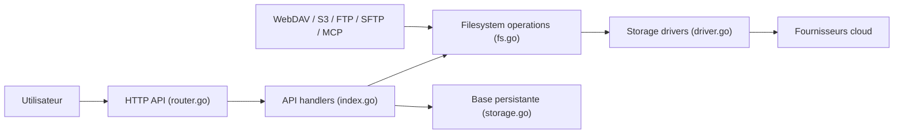

# alist-org/alist

> Web server that lists, previews and shares files from dozens of cloud storages, for people who manage online drives.

## The problem
Files are scattered across several cloud services (Aliyundrive, OneDrive, S3, Google Drive…), each with its own interface and download limits.

## What it actually does
- Mounts several storages behind a single web interface: listing, preview (PDF, Markdown, images, video, Office), direct download.
- Also exposes WebDAV, S3, FTP/SFTP and an MCP server.
- Handles search, archives, protected sharing, offline download (qBittorrent client) and copying between two storages.
- According to the README, it only does 302 redirects / traffic relaying, through the official SDKs.

## How it is wired


## Trying it
```bash
# Aucune commande d'installation dans le README fourni.
# Il mentionne seulement « Docker Deploy » dans la liste des fonctions.
```

## Cost and gotchas
Free. The README warns: risks of account ban or rate limiting on the provider side, at the user's expense. 565 open issues.

## What it is not
Not a storage tool: it stores nothing itself, it relays to the providers. Not a data/AI tool. AGPL-3.0 license: code-sharing obligations if exposed as a modified network service.

## Alternatives
No alternative named in the README (Cloudreve appears there as a supported storage).

## For you
Ignore: useful for aggregating personal clouds, but unrelated to a data/AI/MLOps pipeline, and under AGPL.
