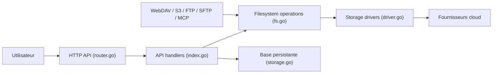

# alist-org/alist

> Serveur web qui liste, prévisualise et partage des fichiers de dizaines de stockages cloud, pour qui gère des disques en ligne.

## Le problème
Les fichiers sont dispersés sur plusieurs services cloud (Aliyundrive, OneDrive, S3, Google Drive…), chacun avec son interface et ses limites de téléchargement.

## Ce que ça fait vraiment
- Monte plusieurs stockages derrière une seule interface web : listage, prévisualisation (PDF, Markdown, images, vidéo, Office), téléchargement direct.
- Expose aussi WebDAV, S3, FTP/SFTP et un serveur MCP.
- Gère recherche, archives, partage protégé, téléchargement hors ligne (client qBittorrent) et copie entre deux stockages.
- Selon le README, il ne fait que des redirections 302 / du relais de trafic, via les SDK officiels.

## Comment c'est branché


## Essayer
```bash
# Aucune commande d'installation dans le README fourni.
# Il mentionne seulement « Docker Deploy » dans la liste des fonctions.
```

## Coût et pièges
Gratuit. Le README avertit : risques de bannissement de compte ou de limitation de débit côté fournisseur, à la charge de l'utilisateur. 565 issues ouvertes.

## Ce que ce n'est pas
Pas un outil de stockage : il ne stocke rien lui-même, il relaie vers les fournisseurs. Pas un outil data/IA. Licence AGPL-3.0 : obligations de partage du code si exposé en service réseau modifié.

## Alternatives
Aucune alternative nommée dans le README (Cloudreve y figure comme stockage pris en charge).

## Pour toi
À ignorer : utile pour agréger des clouds personnels, mais sans lien avec un pipeline data/IA/MLOps, et sous AGPL.

