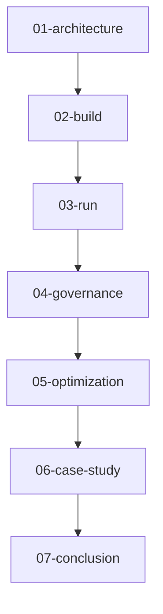

# aliyun/ai-agent-handbook

> Alibaba Cloud's open handbook on the architecture, operation, governance and tuning of AI agents in the enterprise.

## The problem
Moving from a demo agent to a reliable, safe and economical agent in the enterprise lacks structured references.

## What it actually does
A collection of chapters, in Chinese with an English version, following the lifecycle of an agent: architecture, building (Harness, tasks, context, actions), execution (sandbox, AI gateway, multi-agent), governance, optimization (trajectories, reference datasets, bad cases) and use cases. It includes a 2026 survey of developers. Human review and weekly updates announced.

## How it is wired

## Trying it
No documented command: the repository is read online or cloned to browse it.

## Cost and gotchas
Free. Content mainly in Chinese; the reading order is given by the repository's folders. The provided graph is a reading path, not calls between components.

## What it is not
It is not an executable agent platform nor code to install. It reflects the practices of Alibaba Cloud and its customers, not a neutral standard.

## Alternatives
No alternative named in the README.

## For you
To adopt as reading: it covers evaluation, observability and agent trajectories, topics directly relevant to an AI and MLOps profile, provided you read Chinese or the English version.
