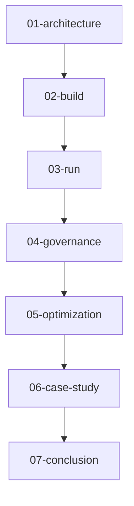

# aliyun/ai-agent-handbook

> Manuel ouvert d'Alibaba Cloud sur l'architecture, l'exploitation, la gouvernance et le réglage d'agents IA en entreprise.

## Le problème
Passer d'un agent de démonstration à un agent fiable, sûr et économique en entreprise manque de références structurées.

## Ce que ça fait vraiment
Un recueil de chapitres, en chinois avec une version anglaise, qui suit le cycle de vie d'un agent : architecture, construction (Harness, tâches, contexte, actions), exécution (sandbox, passerelle IA, multi-agent), gouvernance, optimisation (trajectoires, jeux de données de référence, bad cases) et cas d'usage. Il inclut une enquête 2026 auprès de développeurs. Révision humaine et mises à jour hebdomadaires annoncées.

## Comment c'est branché

## Essayer
Aucune commande documentée : le dépôt se lit en ligne ou se clone pour le parcourir.

## Coût et pièges
Gratuit. Contenu principalement en chinois ; l'ordre de lecture est donné par les dossiers du dépôt. Le graphe fourni est un parcours de lecture, pas un appel entre composants.

## Ce que ce n'est pas
Ce n'est pas une plateforme d'agents exécutable ni un code à installer. Il reflète les pratiques d'Alibaba Cloud et de ses clients, pas un standard neutre.

## Alternatives
Aucune alternative nommée dans le README.

## Pour toi
À adopter en lecture : il couvre évaluation, observabilité et trajectoires d'agents, des sujets directs pour un profil IA et MLOps, à condition de lire le chinois ou la version anglaise.

