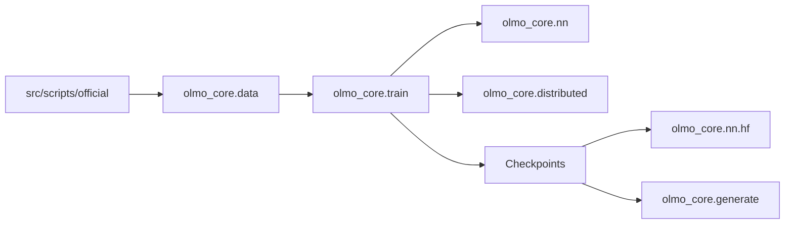

# allenai/OLMo-core

> PyTorch building blocks for modeling and training OLMo models, with the official training scripts.

## The problem
Training an open LLM at scale requires data, parallelism, checkpoints and evaluation assembled by hand.

## What it actually does
The `olmo_core` library with data modules (mixes, tokenization), transformer blocks (attention, MoE, float8), a callback-based training loop, distributed parallelism (data, tensor, pipeline, expert, context), conversion to Hugging Face, generation and evaluation. `src/scripts/official/` contains the OLMo-2 and OLMo-3 recipes, launched with `torchrun`.

## How it is wired


## Trying it
```bash
pip install ai2-olmo-core
torchrun --nproc-per-node=8 src/scripts/official/OLMo2/OLMo-2-0325-32B-train.py \
  --save-folder=/path/to/save/checkpoints
python -m olmo_core.generate.chat https://olmo-checkpoints.org/ai2-llm/Olmo-3-1025-7B/stage3/step11921/ --max-new-tokens 512
```

## Cost and gotchas
Free, but real training requires GPU clusters; the Docker images are tested on in-house H100s and may not work on your hardware. Several backends (flash-attn, TransformerEngine, grouped_gemm) must be installed separately.

## What it is not
Not a ready-to-serve inference tool: the README points to transformers and vLLM. No weights included: they are on Hugging Face.

## Alternatives
OLMo Eval and olmes for evaluation; Hugging Face Transformers and vLLM for inference.

## For you
Worth watching: a readable, maintained reference for LLM training code, useful if you pre-train or do heavy fine-tuning; otherwise not useful.
