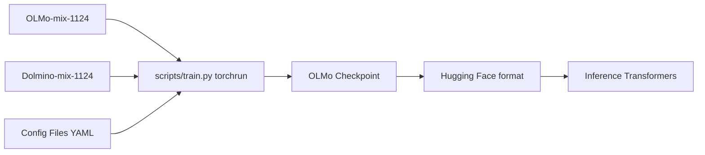

# allenai/OLMo

> Open training code and checkpoints of the OLMo 2 language models, for researchers and practitioners.

## The problem
Most "open" LLMs publish the weights but neither the data, nor the configs, nor the intermediate checkpoints.

## What it actually does
Two-stage training: web data (OLMo-mix-1124) then targeted data (Dolmino-mix-1124), YAML configs provided.
Checkpoints every 1000 steps for 1B, 7B, 13B, in OLMo and Hugging Face formats; public WandB runs.
Model soup (weight averaging) in stage 2; instruct variants.
Inference via Transformers, 8-bit quantization, Modal deployment example.

## How it is wired


## Trying it
```bash
git clone https://github.com/allenai/OLMo.git
cd OLMo
pip install -e .[all]
pip install ai2-olmo
torchrun --nproc_per_node=8 scripts/train.py {path_to_train_config}
python scripts/train.py configs/tiny/OLMo-20M.yaml --save_overwrite
```

## Cost and gotchas
Reproducing the training requires 8 GPUs or more; data streamed over HTTP, to be downloaded for large scale.
The 32B and new trainings have moved to OLMo-core.

## What it is not
Not the most recent repo: OLMo-core is taking over.
Not an inference server.

## Alternatives
- OLMo-core: new trainer, required for the 32B.
- OLMo Eval / olmes: for evaluation.

## For you
Watch: rare reference of a truly open LLM, valuable for understanding or reproducing a pretraining, but aim at OLMo-core for new work.
