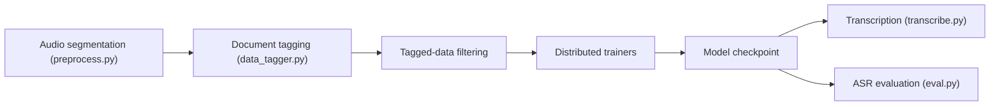

# allenai/OLMoASR

> Open English speech recognition models and a complete pipeline from data to evaluation, published by Ai2.

## The problem
Robust speech recognition models rarely have their data and training method published.

## What it actually does
Shows the steps: transcripts in JSONL, 30 s audio segmentation, tagging and filtering, distributed training (`torchrun`, DDP or FSDP), evaluation. Six sizes (tiny.en to large.en-v2) trained on OLMoASR-Mix, 1 M hours. Transcription in Python with per-sentence timestamps. WER tables provided.

## How it is wired


## Trying it
```bash
git clone https://github.com/allenai/OLMoASR.git
pip install -r requirements/requirements.txt
pip install -e .
python -c "import olmoasr; m = olmoasr.load_model('medium', inference=True); print(m.transcribe('audio.mp3'))"
```

## Cost and gotchas
ffmpeg and wandb required; multi-GPU training; data to download from Hugging Face. Last push on 2025-10-29.

## What it is not
Not multilingual: English only. No CLI ("under development"). The "Citing" section says "Coming soon".

## Alternatives
No alternative named (Whisper is only alluded to through the name of the result format, with no explicit mention).

## For you
Worth watching: a reproducible base for training or comparing English ASR, with open weights and data.
