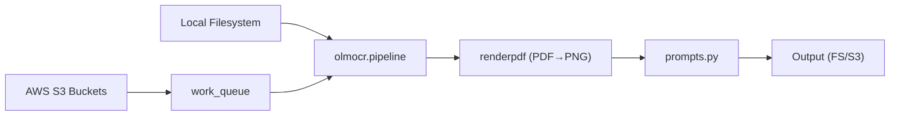

# allenai/olmocr

> Pipeline that converts PDFs and images into clean Markdown via a 7B-parameter VLM.

## The problem
Extracting usable text from scanned, multi-column PDFs with tables or equations gives messy text with classic OCR tools.

## What it actually does
Renders each page (poppler), then sends it to olmOCR-2-7B served by vLLM, locally or on an OpenAI-compatible server.
Produces Markdown or Dolma JSON in natural reading order, without headers or footers.
Scales out through a work queue in S3 shared by several nodes.
Provides olmOCR-Bench (7,000 tests) and the SFT/GRPO training code.

## How it is wired


## Trying it
```bash
conda create -n olmocr python=3.11
conda activate olmocr
pip install olmocr[gpu] --extra-index-url https://download.pytorch.org/whl/cu128
olmocr ./localworkspace --markdown --pdfs olmocr-sample.pdf
docker pull alleninstituteforai/olmocr:latest-with-model
```

## Cost and gotchas
Locally: NVIDIA GPU with 12 GB minimum and 30 GB of disk. Via an external provider, about $0.07–0.10 per million input tokens according to the README table.

## What it is not
Not a lightweight OCR for CPU. The README contains a truncated code block ("Combined Installation" section). On the README's benchmark, Chandra OCR and Infinity-Parser do slightly better.

## Alternatives
- Marker: scored 76.1 on the README benchmark.
- PaddleOCR-VL: 80.0.
- Chandra OCR: 83.1, above olmOCR v0.4.0 (82.4).

## For you
Adopt to prepare RAG corpora from PDFs: Apache-2.0, backed by AI2, with a published benchmark and a remote server mode if you have no GPU.
