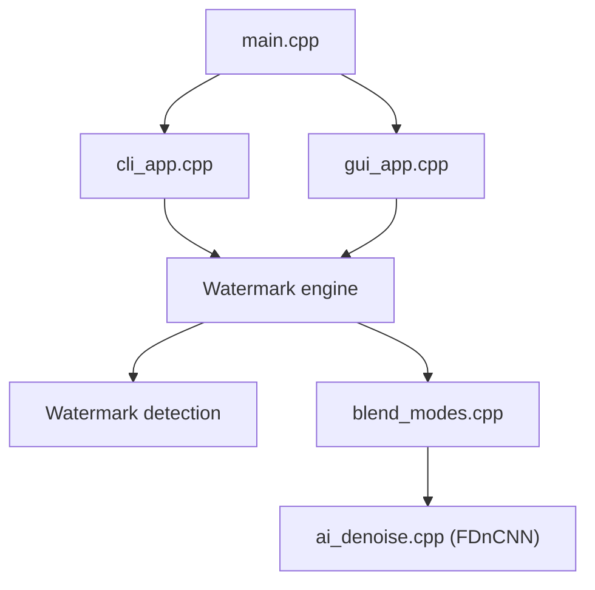

# allenk/GeminiWatermarkTool

> Local tool that removes the visible logo from Gemini images, from the command line or a graphical interface.

## The problem
Images generated by Gemini carry a semi-transparent logo in the bottom right. The author offers to remove it without going through an online service or a regeneration that distorts the text.

## What it actually does
It detects the logo (three-stage correlation with a confidence score), then inverts the alpha blending using calibrated 48×48 and 96×96 masks. Optional cleanup (inpainting or the FDnCNN network via NCNN/Vulkan, CPU fallback) handles residues. It processes a file or a folder, and exists as CLI, GUI, on Windows/Linux/macOS/Android. It does not remove SynthID, the invisible marking. Video (Veo) is a separate repository, and the MCP server another.

## How it is wired


## Trying it
```bash
GeminiWatermarkTool watermarked.jpg

GeminiWatermarkTool -i watermarked.jpg -o clean.jpg

GeminiWatermarkTool -i ./input_folder/ -o ./output_folder/ --denoise ai
```

## Cost and gotchas
Free, standalone binary with no dependencies, no account or key. Unsigned binaries (OS warnings on first launch); the simple mode overwrites the original, so back up first.

## What it is not
Not a tool without stakes: the author reserves it for personal and educational use, and removing a marking may violate the service's terms of use or applicable law depending on the jurisdiction. It targets Gemini's current pattern and may stop working if that changes.

## Alternatives
- VeoWatermarkRemover: a separate repository by the same author, for Veo videos.

## For you
Ignore: it brings nothing to a data/MLOps pipeline, and removing the marking from AI-generated content adds a legal and compliance (traceability) risk that your use does not justify.
