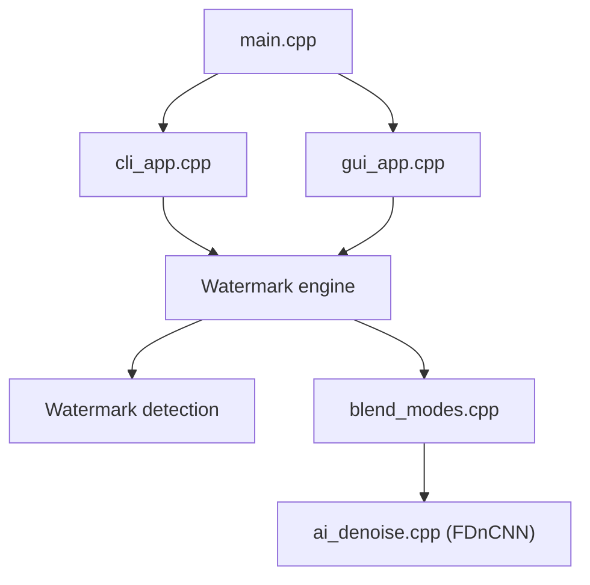

# allenk/GeminiWatermarkTool

> Outil local qui retire le logo visible des images Gemini, en ligne de commande ou en interface graphique.

## Le problème
Les images générées par Gemini portent un logo semi-transparent en bas à droite. L'auteur propose de le retirer sans passer par un service en ligne ni par une régénération qui déforme le texte.

## Ce que ça fait vraiment
Il détecte le logo (corrélation en trois étapes avec score de confiance), puis inverse le mélange alpha avec des masques calibrés 48×48 et 96×96. Un nettoyage optionnel (inpainting ou réseau FDnCNN via NCNN/Vulkan, repli CPU) traite les résidus. Il traite un fichier ou un dossier, et existe en CLI, GUI, Windows/Linux/macOS/Android. Il ne retire pas SynthID, le marquage invisible. La vidéo (Veo) est un dépôt à part, et le serveur MCP un autre.

## Comment c'est branché


## Essayer
```bash
GeminiWatermarkTool watermarked.jpg

GeminiWatermarkTool -i watermarked.jpg -o clean.jpg

GeminiWatermarkTool -i ./input_folder/ -o ./output_folder/ --denoise ai
```

## Coût et pièges
Gratuit, binaire autonome sans dépendance, sans compte ni clé. Binaires non signés (alertes OS au premier lancement) ; le mode simple écrase l'original, donc sauvegarde préalable.

## Ce que ce n'est pas
Pas un outil sans enjeu : l'auteur le réserve à un usage personnel et éducatif, et la suppression d'un marquage peut contrevenir aux conditions d'utilisation du service ou au droit applicable selon la juridiction. Il vise le motif actuel de Gemini et peut cesser de fonctionner si celui-ci change.

## Alternatives
- VeoWatermarkRemover : dépôt séparé du même auteur, pour les vidéos Veo.

## Pour toi
À ignorer : il n'apporte rien à un pipeline data/MLOps et retirer le marquage d'un contenu généré par IA ajoute un risque juridique et de conformité (traçabilité) que ton usage ne justifie pas.

