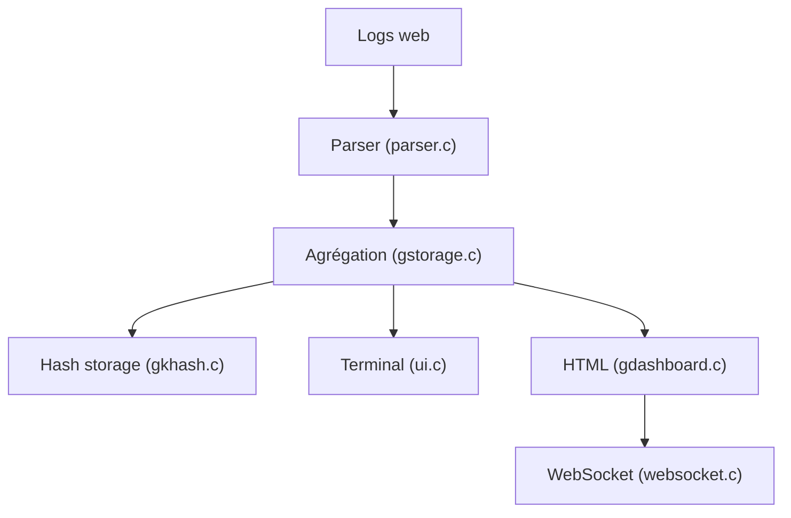

# allinurl/goaccess

> Real-time web log analyzer, in the terminal or as an HTML dashboard, for admins.

## The problem
Reading raw access logs to spot traffic, slowness and suspicious activity is slow and unreadable.

## What it actually does
Parses logs (Apache, Nginx, CloudFront, S3, Caddy, Traefik…) and aggregates visitors, bandwidth, response times, virtual hosts, UTM campaigns, bots, ASNs and GeoIP. Outputs to the terminal, real-time HTML (built-in WebSocket server, JWT), JSON or CSV. Disk persistence for incremental processing. Only dependency: ncurses.

## How it is wired


## Trying it
```bash
goaccess access.log
goaccess access.log -a > report.html
goaccess access.log -a -d -o report.json
tail -f access.log | goaccess -
goaccess access.log -o report.html --real-time-html
```

## Cost and gotchas
Free. In-memory tables limit the dataset size (persistence is possible). WebSocket port 7890 must be opened; TLS requires a certificate and key.

## What it is not
Not a distributed observability platform nor a SIEM. Windows only via Cygwin or WSL.

## Alternatives
No alternative named in the README.

## For you
Watch: very useful for quickly inspecting the logs of an inference endpoint behind Nginx, without a heavy stack.
