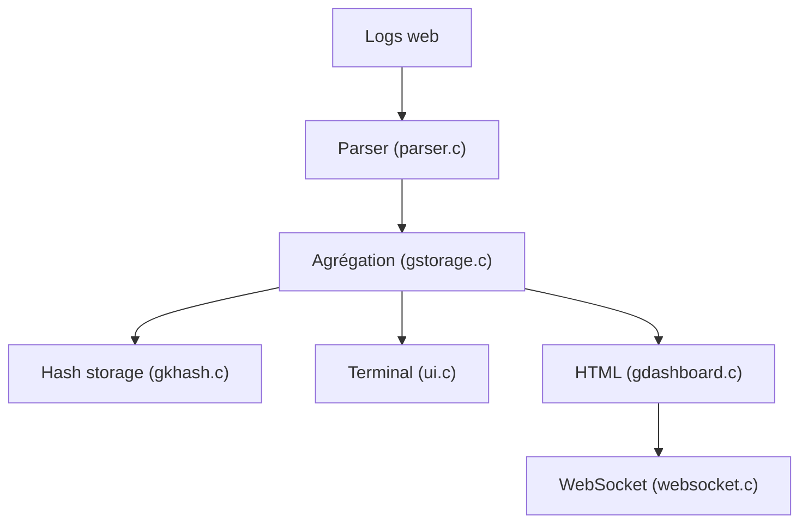

# allinurl/goaccess

> Analyseur de logs web en temps réel, dans le terminal ou en tableau de bord HTML, pour admins.

## Le problème
Lire des logs d'accès bruts pour repérer trafic, lenteurs et activité suspecte est lent et illisible.

## Ce que ça fait vraiment
Analyse les logs (Apache, Nginx, CloudFront, S3, Caddy, Traefik…) et agrège visiteurs, bande passante, temps de réponse, hôtes virtuels, campagnes UTM, robots, ASN et GeoIP. Sort en terminal, HTML temps réel (serveur WebSocket intégré, JWT), JSON ou CSV. Persistance sur disque pour le traitement incrémental. Seule dépendance : ncurses.

## Comment c'est branché


## Essayer
```bash
goaccess access.log
goaccess access.log -a > report.html
goaccess access.log -a -d -o report.json
tail -f access.log | goaccess -
goaccess access.log -o report.html --real-time-html
```

## Coût et pièges
Gratuit. Les tables en mémoire limitent la taille du jeu de données (persistance possible). Port WebSocket 7890 à ouvrir ; TLS demande certificat et clé.

## Ce que ce n'est pas
Pas une plateforme d'observabilité distribuée ni un SIEM. Windows seulement via Cygwin ou WSL.

## Alternatives
Aucune alternative nommée dans le README.

## Pour toi
Surveiller : très utile pour inspecter vite les logs d'un endpoint d'inférence derrière Nginx, sans pile lourde.

