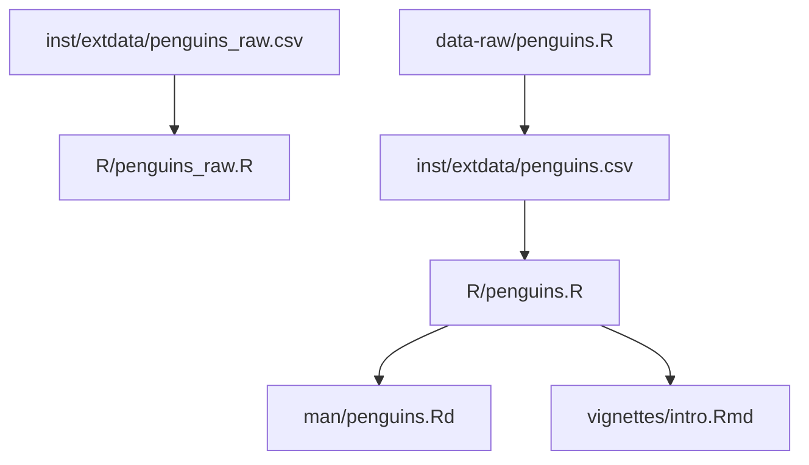

# allisonhorst/palmerpenguins

> Dataset of 344 penguins from the Palmer archipelago, an alternative to iris for teaching visualization.

## The problem
The `iris` dataset is worn out for teaching data exploration and visualization.

## What it actually does
Provides two tables: `penguins` (simplified version, 8 variables) and `penguins_raw` (17 original variables), for 3 species and 3 islands. The CSVs in `inst/extdata` are exposed by `R/penguins.R` and `R/penguins_raw.R`. Also contains illustrations and vignettes.

## How it is wired


## Trying it
```r
install.packages("palmerpenguins")
library(palmerpenguins)
head(penguins)
```

## Cost and gotchas
Free, CC0 license. R is required. Missing values (NA) must be handled. Publishing results requires contacting the researcher and following the LTER access policy. Last push in September 2024.

## What it is not
Not a large dataset: 344 rows for teaching. It is not a model.

## Alternatives
`iris`, which this package aims to replace.

## For you
Adopt for your demos and courses: a clean, free dataset that is more engaging than iris, even though it is packaged for R.
