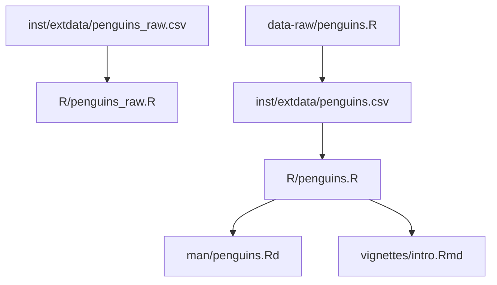

# allisonhorst/palmerpenguins

> Jeu de données de 344 manchots de l'archipel Palmer, alternative à iris pour enseigner la visualisation.

## Le problème
Le jeu `iris` est usé pour enseigner l'exploration de données et la visualisation.

## Ce que ça fait vraiment
Fournit deux tables : `penguins` (version simplifiée, 8 variables) et `penguins_raw` (17 variables d'origine), pour 3 espèces et 3 îles. Les CSV de `inst/extdata` sont exposés par `R/penguins.R` et `R/penguins_raw.R`. Contient aussi des illustrations et des vignettes.

## Comment c'est branché


## Essayer
```r
install.packages("palmerpenguins")
library(palmerpenguins)
head(penguins)
```

## Coût et pièges
Gratuit, licence CC0. Il faut R. Valeurs manquantes (NA) à gérer. Publier des résultats suppose de contacter la chercheuse et de suivre la politique d'accès LTER. Dernier push en septembre 2024.

## Ce que ce n'est pas
Pas un jeu de données volumineux : 344 lignes pour la pédagogie. Ce n'est pas un modèle.

## Alternatives
`iris`, que ce paquet cherche à remplacer.

## Pour toi
À adopter pour tes démonstrations et cours : jeu de données propre, libre et plus parlant qu'iris, même s'il est packagé pour R.

