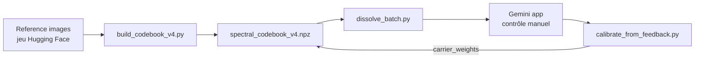

# aloshdenny/reverse-SynthID

> Research on the robustness of Google's invisible SynthID watermark: detection, spectral analysis and circumvention.

## The problem
Watermarks on AI-generated images are presented as reliable, but their real robustness is poorly documented outside Google. This repository measures it from the outside, without access to the encoder.

## What it actually does
- Spectral analysis (FFT, phase coherence) of reference Gemini images, to spot resolution-dependent carrier frequencies.
- Local detector, with a "codebook" per model and per resolution (~220 MB for 14 profiles).
- Watermark removal pipelines (V3 spectral, V4 in 7 steps), with manual validation in the Gemini app.
- Fork with a drag-and-drop desktop application (gui/README.md).

## How it is wired


## Trying it
Only installation and detection are reproduced here; the watermark removal commands exist in the README and are deliberately not reproduced.
```bash
git clone https://github.com/aloshdenny/reverse-SynthID.git
cd reverse-SynthID
python -m venv venv
source venv/bin/activate
pip install -r requirements.txt
python src/extraction/robust_extractor.py detect image.png \
    --codebook artifacts/codebook/robust_codebook.pkl
```

## Cost and gotchas
Free, but the regeneration step requires torch + diffusers (GPU recommended) and the V4 codebook weighs ~220 MB. Validation goes through the Gemini app, so a Google account and a manual action are needed.

## What it is not
Not a production detector: the README claims ~90% accuracy on a small set (20 images validated for circumvention). Results hold for Gemini at a given point in time and may be invalidated by Google. The license is not identified by GitHub. Declared use: research and education; presenting AI content as human is explicitly forbidden by the author, and may be illegal depending on the jurisdiction.

## Alternatives
- SynthID (Google DeepMind): the system under study, cited in the README with its paper (arXiv:2510.09263).
- Reference dataset `aoxo/reverse-synthid` on Hugging Face: to reproduce the analysis without the circumvention code.

## For you
Worth watching as a study of AI watermark robustness: useful if you assess content provenance, but its main use (removing the mark) is double-edged and the license remains to be clarified.
