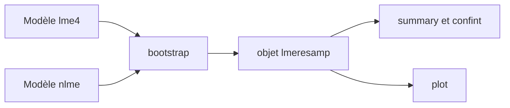

# aloy/lmeresampler

> R package for bootstrapping linear mixed models fitted with lme4 or nlme.

## The problem
When the assumptions of a mixed model are violated, bias and standard errors become wrong. Classical parametric tests no longer hold.

## What it actually does
Provides five bootstraps: parametric, residual, case, wild and random-effects block. Output: an `lmeresamp` object with `print`, `summary`, `confint` and `plot`. Parallelization is described in the vignette.

## How it is wired
Simplified diagram based on the fiche, no diagram provided.



## Trying it
```r
install.packages("lmeresampler")
library(lmeresampler)
library(lme4)
vcmodA <- lmer(mathAge11 ~ mathAge8 + gender + class + (1 | school), data = jsp728)
lmer_par_boot <- bootstrap(vcmodA, .f = fixef, type = "parametric", B = 100)
```

## Cost and gotchas
Free. Repeated bootstrapping costs computing time. License not declared in the catalog.

## What it is not
Not a model-fitting tool: it relies on lme4 or nlme.

## Alternatives
No alternative named in the README.

## For you
Worth watching: useful if you do inferential statistics in R on hierarchical data, otherwise marginal.
