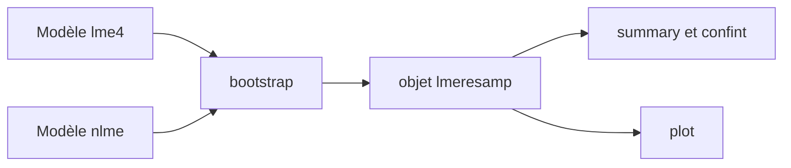

# aloy/lmeresampler

> Paquet R de bootstrap pour modèles linéaires mixtes ajustés avec lme4 ou nlme.

## Le problème
Quand les hypothèses d'un modèle mixte sont violées, biais et erreurs standard deviennent faux. Les tests paramétriques classiques ne tiennent plus.

## Ce que ça fait vraiment
Fournit cinq bootstraps : paramétrique, résidus, cas, wild et blocs d'effets aléatoires. Sortie : un objet `lmeresamp` avec `print`, `summary`, `confint` et `plot`. La parallélisation est décrite dans la vignette.

## Comment c'est branché
Schéma simplifié d'après la fiche, sans diagramme fourni.



## Essayer
```r
install.packages("lmeresampler")
library(lmeresampler)
library(lme4)
vcmodA <- lmer(mathAge11 ~ mathAge8 + gender + class + (1 | school), data = jsp728)
lmer_par_boot <- bootstrap(vcmodA, .f = fixef, type = "parametric", B = 100)
```

## Coût et pièges
Gratuit. Le bootstrap répété coûte du temps de calcul. Licence non déclarée dans le catalogue.

## Ce que ce n'est pas
Pas un outil d'ajustement de modèles : il repose sur lme4 ou nlme.

## Alternatives
Aucune alternative nommée dans le README.

## Pour toi
À surveiller : utile si tu fais de la statistique inférentielle en R sur données hiérarchiques, sinon marginal.

