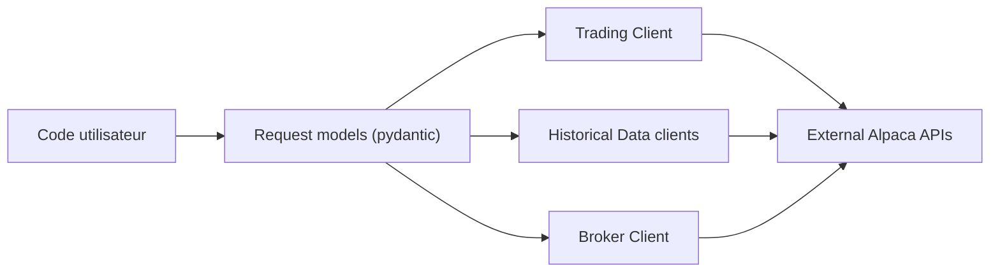

# alpacahq/alpaca-py

> Alpaca's official Python SDK for trading, fetching market data and building brokerage applications.

## The problem
Manually calling a broker's REST and WebSocket APIs to place orders and load history is tedious and error-prone.

## What it actually does
Separate clients for the Trading API, the Market Data API (stocks, crypto, options, news, historical and streaming) and the Broker API. Requests are modeled as objects validated by pydantic; bars convert to a pandas DataFrame via `.df`. Sandbox available. Crypto data does not require a key.

## How it is wired


## Trying it
```shell
pip install alpaca-py
```
```python
from alpaca.data.historical import CryptoHistoricalDataClient
client = CryptoHistoricalDataClient()
```

## Cost and gotchas
Python 3.10+. Free Alpaca account to create; paper-mode keys for testing. Live trading involves real money.

## What it is not
Not a strategy or backtesting engine. Gives no advice; depends entirely on the Alpaca service.

## Alternatives
alpaca-trade-api, the old SDK cited in the README, replaced by this one.

## For you
Worth watching: handy for feeding financial datasets into pandas, but tied to a third-party broker and an account.
