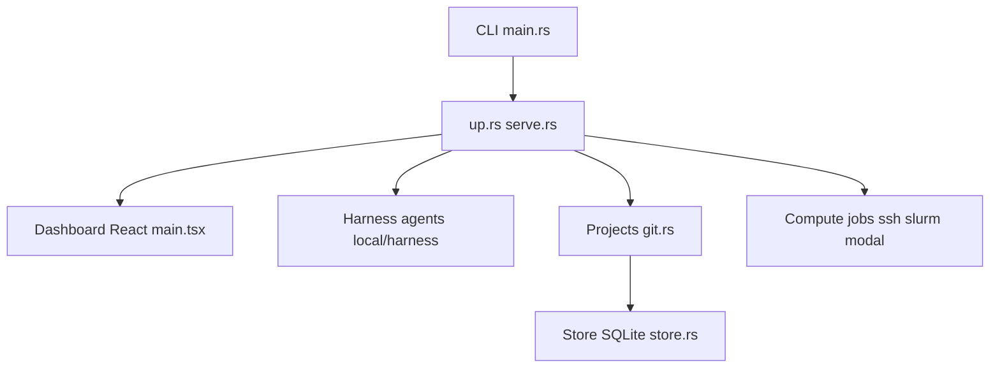

# alphaXiv/OpenResearch

> Local workstation for research agents: experiments, logs and compute, for ML researchers.

## The problem
Coding agents launch experiments without structured memory; results, logs and past choices get lost between sessions.

## What it actually does
A local Rust service (`orx up`, dashboard on 127.0.0.1:4791) launches agent sessions (Claude, Codex, Cursor, OpenCode) in isolated git worktrees. Each experiment is recorded in SQLite with code, logs and artifacts. Compute: local, SSH, Slurm, Kubernetes, Ray, Hugging Face, Modal. Integrations with alphaXiv, bioRxiv, PubMed.

## How it is wired


## Trying it
```sh
curl -LsSf https://openresearch.sh/install.sh | sh
orx up
```

## Cost and gotchas
Managed compute requires an account. Anonymous telemetry is enabled by default in official builds (`orx telemetry off` to disable it). The CLI binary is not signed on Mac.

## What it is not
Not a cloud service: data stays local by default. It brings no model: you need your own agent.

## Alternatives
No alternative named in the README.

## For you
Worth watching if you run ML experiments with agents: local traceability is useful, but turn off telemetry and test the worktree isolation.
