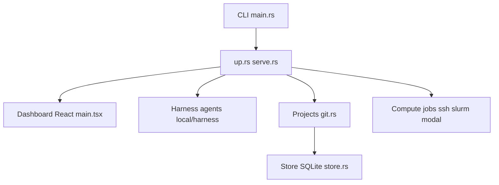

# alphaXiv/OpenResearch

> Poste de travail local pour agents de recherche : expériences, journaux et calcul, pour chercheurs en ML.

## Le problème
Les agents de code lancent des expériences sans mémoire structurée ; les résultats, journaux et choix passés se perdent entre sessions.

## Ce que ça fait vraiment
Un service Rust local (`orx up`, tableau de bord sur 127.0.0.1:4791) lance des sessions d'agents (Claude, Codex, Cursor, OpenCode) dans des worktrees git isolés. Chaque expérience est consignée en SQLite avec code, journaux, artefacts. Calcul : local, SSH, Slurm, Kubernetes, Ray, Hugging Face, Modal. Intégrations alphaXiv, bioRxiv, PubMed.

## Comment c'est branché


## Essayer
```sh
curl -LsSf https://openresearch.sh/install.sh | sh
orx up
```

## Coût et pièges
Le calcul managé nécessite un compte. Télémétrie anonyme activée par défaut dans les builds officiels (`orx telemetry off` pour la couper). Le binaire CLI n'est pas signé sur Mac.

## Ce que ce n'est pas
Pas un service cloud : les données restent locales par défaut. N'apporte pas de modèle : il faut ton propre agent.

## Alternatives
Aucune alternative nommée dans le README.

## Pour toi
À surveiller si tu mènes des expériences ML avec des agents : la traçabilité locale est utile, mais coupe la télémétrie et teste l'isolation des worktrees.

