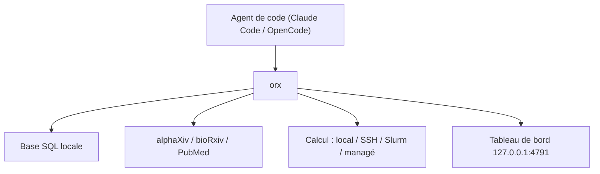

# alphaXiv/openresearch-cli

> Local workspace for research agents that keeps a memory of every experiment.

## The problem
Agents that run experiments forget past results and do not link them to the literature.

## What it actually does
Works with your coding agent (Claude Code, or a local model via OpenCode). Records each experiment in a local SQL database, with logs, code and artifacts on your machine. Connects to alphaXiv, bioRxiv and PubMed to ground hypotheses. Runs locally, over SSH, Slurm or on managed compute. Local dashboard on port 4791.

## How it is wired

Simplified diagram based on the README; no diagram provided.

## Trying it
```sh
curl -LsSf https://openresearch.sh/install.sh | sh
orx up
orx telemetry off
```

## Cost and gotchas
Local and free, but an account is needed for managed compute. The `install.sh` binary is not signed and may be blocked on a managed Mac: use the desktop application. The coding agent remains at your expense.

## What it is not
Not an agent in itself. Official releases send usage statistics and detailed agent feedback, with a random installation identifier; can be disabled.

## Alternatives
No alternative named in the README.

## For you
Worth watching: the idea of a local experiment memory linked to the literature suits a research/ML profile well, but the project is recent (created in June 2026) and sends telemetry by default.
